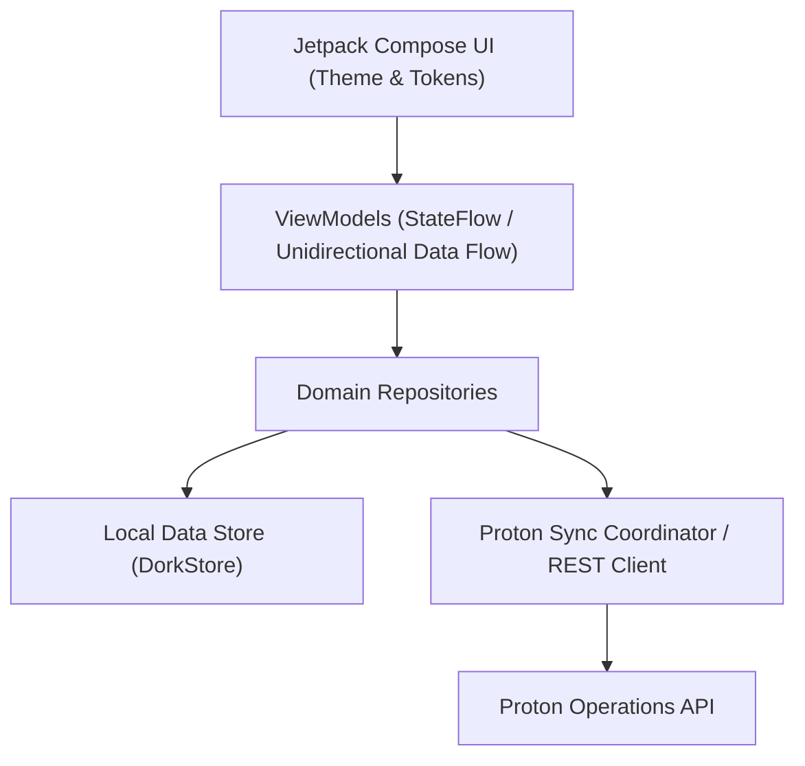

# Dork — Native Android Patient Healthcare Application

> **“A calm, intelligent, private home for everything related to my healthcare.”**

Dork is the native Android patient-facing application designed for the Proton healthcare platform ecosystem. It provides an Apple-quality, clinical-grade longitudinal health experience built with **Kotlin**, **Jetpack Compose**, and the **Proton REST Sync API**.

---

## 🌟 Core Features & Highlights

- **Original Dork Design Language**: Calm, restrained neutral foundation, deep teal/slate accents, generous whitespace, strong numeric hierarchy, and genuine dark mode.
- **Authoritative Date of Birth & Dynamic Age**: Strict adherence to ISO-8601 `YYYY-MM-DD` demographic representation with dynamic leap-year and timezone safe age calculation.
- **Context-Aware Home**: Immediate answers to *"What do I need to know about my health right now?"* featuring appointment status, upcoming medication doses, vitals snapshot, and recent records.
- **Doctor Discovery & Care Booking**: Find healthcare providers by specialty, clinic location, and real availability. Seamless booking flow with interactive slot picker and confirmation state.
- **Interactive Cases Architecture**: Longitudinal episode-of-care tracker structuring clinical encounters into discrete Cases with active status timelines, clinical action checkpoints, and outbox sync.
- **Background KeepAlive Reliability**: Foreground service interlock (`DorkKeepAliveService`) keeping background sync alive across aggressive OEM battery throttling.
- **Pre-Consultation Clinical Preparation**: Structured patient intake flow capturing chief complaints, duration, severity (1–10 scale), and symptom checklists.
- **Longitudinal Health Journey**: Chronological timeline uniting doctor consultations, lab reports (CBC, metabolic panels), prescriptions, and diagnostic imaging.
- **Medications & Non-Judgmental Adherence**: Active prescriptions, scheduled daily dose time slots with "Mark Taken", "Skip", and non-punitive adherence tracking.
- **Doctor-Patient Messaging**: Practitioner communication channel with care context, attachments, and delivery confirmations over authenticated TLS.
- **Dork AI Health Assistant**: *"Your health information, explained."* Features clinical citations to patient records and strict safety guardrails that instantly flag urgent symptoms and require physician oversight.
- **Emergency Medical ID**: First-responder emergency profile with blood group (O+), severe allergies (Penicillin), active medications, and one-tap emergency contact dialing.
- **Offline-First Architecture**: Persistent DorkStore local cache for offline / demo mode and durable outbox REST sync coordinator for live Proton API servers.

---

## 🏗️ Architecture Overview



See [ARCHITECTURE.md](ARCHITECTURE.md) for module boundaries and data flow specifications.

---

## 📚 Project Documentation

1. [ARCHITECTURE.md](ARCHITECTURE.md) — System architecture, unidirectional state flow, and repository layer.
2. [DESIGN_SYSTEM.md](DESIGN_SYSTEM.md) — Centralized design tokens (colors, typography, spacing, components).
3. [FHIR_MAPPING.md](FHIR_MAPPING.md) — Mapping between UI models and FHIR R4 resources.
4. [SECURITY.md](SECURITY.md) — PHI protection, credential isolation, and screen security.
5. [DEVELOPMENT.md](DEVELOPMENT.md) — Setup instructions, Gradle configuration, and build commands.
6. [TESTING.md](TESTING.md) — Unit test suite, critical safety cases, and verification.

---

## 🚀 Quick Start

### Prerequisites
- JDK 21 (or Android Studio Ladybug / Meerkat / 2024.3+)
- Android SDK 36 (Android 16 platform)
- Gradle 9.1 (included via `./gradlew`)

### Build and Run Tests
```bash
cd apps/dork-android

# Run comprehensive unit test suite
./gradlew test

# Assemble debug APK
./gradlew assembleDebug
```
The output APK is generated at `app/build/outputs/apk/debug/app-debug.apk`.
