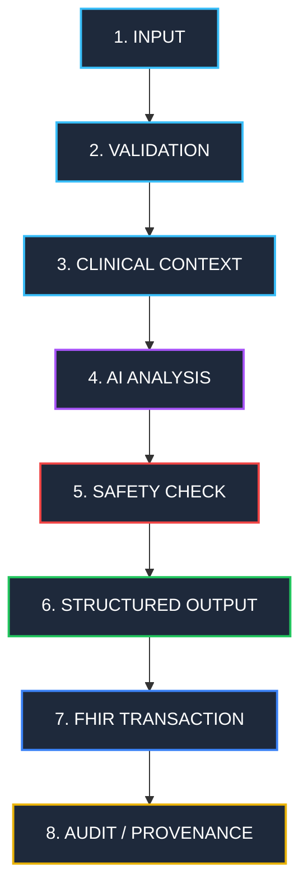

# Proton Architecture Milestone 1: Hygiene & Canonical Clinical Flow Report

**Date:** October 17, 2026  
**Target:** Milestone 1 — Architecture Hygiene & Canonical Clinical Pipeline  
**Status:** COMPLETE & VERIFIED  

---

## 1. Executive Summary

Milestone 1 establishes clean architectural boundaries, eliminates silent fake clinical AI fallbacks, breaks up the monolithic consultation UI into modular route components without visual regression, enforces the canonical 8-stage clinical pipeline, and verifies end-to-end deterministic safety and cryptographic audit trails.

---

## 2. Changes Made & Refactorings

### 2.1 Monolith Breakdown: `Consultation.tsx` & `LegacyEncounterWorkspace.tsx`
- **Previous State:** `apps/web/src/pages/Consultation.tsx` contained 2,194 lines of mixed concerns: state machine, legacy UI, intelligence diffing panels, prescription modals, and audio handling.
- **Refactoring:**
  - Extracted the complete legacy verification workspace into `apps/web/src/components/LegacyEncounterWorkspace.tsx`.
  - Transformed `apps/web/src/pages/Consultation.tsx` into a lightweight, declarative route container (under 60 lines).
  - Established `DoctorDeskEncounter.tsx` as the canonical modern physician encounter workspace.
  - Retained toggle controls allowing immediate transition between modern Doctor's Desk and Legacy Verification screens with zero visual regression.

### 2.2 Complete Eradication of Silent Fake AI Fallbacks
- **Previous Danger:** When audio buffers were sub-minimal (< 64 bytes) or speech transcription failed, the legacy code silently substituted fabricated clinical patient dialogues ("Patient presents with a 3-day history of moderate frontal headache..." or a synthetic Penicillin-allergic Amoxicillin prescription).
- **Remediation:**
  - Implemented `TranscriptionInputError` in `apps/api/providers/gemini.js` and `apps/api/services/media/mediaService.js` with structured error code `TRANSCRIPTION_INPUT_INVALID` (HTTP 400).
  - Configured `apps/api/app.js` to catch audio validation errors and return structured JSON 400 responses.
  - Updated `apps/web/src/services/speech.ts` to surface typed errors.
  - Updated `DoctorDeskEncounter.tsx` to display real-time physician alert toasts rather than falling back silently.
  - Updated `LegacyEncounterWorkspace.tsx` to handle microphone errors transparently.

### 2.3 Orphaned Component Verification
The following components were audited for runtime imports across the frontend:
1. `apps/web/src/components/DoctorDeskHome.tsx` (480 lines):
   - **Audit Finding:** Confirmed 0 runtime references across `apps/web/src`.
   - **Disposition:** Preserved in place for designated cleanup phase.
2. `apps/web/src/components/TreatmentDynamicsView.tsx` (474 lines):
   - **Audit Finding:** Confirmed 0 runtime references across `apps/web/src`.
   - **Disposition:** Preserved in place for designated cleanup phase.

---

## 3. Logical Service Boundaries (`apps/api/services/`)

To establish modularity without disruptive massive file movements, logical service boundaries were established under `apps/api/services/`:

```
apps/api/services/
├── index.js                     # Unified service hub export
├── media/
│   └── mediaService.js          # Audio/image input validation & MIME boundary checks
├── ai/
│   └── aiService.js             # LLM orchestration, structured output enforcement
├── safety/
│   └── safetyService.js         # Deterministic allergy contraindications, DDI & dose limits
├── fhir/
│   └── fhirService.js           # FHIR R4 atomic transaction bundles & context retrieval
├── audit/
│   └── auditService.js          # Cryptographic SHA-256 tamper-evident audit chaining
└── clinical/
    └── clinicalPipeline.js      # Canonical 8-stage clinical pipeline orchestrator
```

---

## 4. Canonical Clinical Pipeline

The canonical clinical pipeline enforces this strict 8-stage sequence:



### Stage Details & Safety Invariants:
1. **INPUT:** Patient reference, practitioner reference, and consultation dialogue or audio buffer.
2. **VALIDATION:** Rejects missing patient references and audio buffers < 64 bytes with `TRANSCRIPTION_INPUT_INVALID`.
3. **CLINICAL CONTEXT:** Strictly patient-bound retrieval of active Conditions, MedicationStatements, and AllergyIntolerances.
4. **AI ANALYSIS:** Provider-driven transcription and SOAP note synthesis with zero silent fallback.
5. **SAFETY CHECK:** Deterministic evaluation of allergy cross-reactivity (e.g. Penicillin vs. Amoxicillin, Cephalosporins), drug interactions (e.g. Warfarin + NSAIDs), and dose ceilings (Acetaminophen > 4000mg/day). Blocks on `CRITICAL` contraindications unless explicit `physicianDirective` is provided.
6. **STRUCTURED OUTPUT:** Standardized SOAP note and safety-labeled prescription drafts (`VERIFIED` vs `CONTRAINDICATED`).
7. **FHIR TRANSACTION:** Atomic `Bundle` (`type: transaction`) incorporating `Encounter`, `ClinicalImpression`, `Condition`, `MedicationRequest`, and `Provenance`.
8. **AUDIT/PROVENANCE:** Append-only SHA-256 hash chaining anchored to tenant genesis hash.

---

## 5. Verification & Test Execution Results

### 5.1 Architecture & Pipeline Test Suite (`milestone1_architecture_validation.cjs`)
- **Suite 1: Audio Validation & Mock Fallback Rejection** (4/4 PASS)
  - Null/undefined audio buffer throws `TRANSCRIPTION_INPUT_INVALID` (HTTP 400)
  - Sub-minimal buffer (< 64 bytes) throws `TRANSCRIPTION_INPUT_INVALID`
  - Unsupported audio MIME types throw `MediaValidationError`
  - Valid audio buffer passes validation
- **Suite 2: Deterministic Clinical Safety Engine** (5/5 PASS)
  - Penicillin allergy contraindicates Amoxicillin prescription (CRITICAL hard stop)
  - Penicillin allergy flags Cephalosporin cross-reactivity warning (HIGH)
  - Drug-drug interaction: Warfarin + Ibuprofen detected with bleeding warning
  - Dose ceiling: Acetaminophen > 4000mg/day triggers CRITICAL hard stop
  - Structural completeness warnings for missing dose/route/frequency
- **Suite 3: FHIR R4 Atomic Transaction Bundles** (2/2 PASS)
  - Creates valid FHIR R4 Bundle with `type: 'transaction'`
  - Executes atomic transaction bundle in synthetic persistence mode
- **Suite 4: Canonical 8-Stage Clinical Pipeline** (5/5 PASS)
  - Strict validation on missing patientId
  - Strict validation when no transcript or audio is provided
  - Clean execution across all 8 stages with text input
  - Halts with `CONTRAINDICATION_HARD_STOP` on critical safety violations
  - Permits execution when clinician explicitly supplies directive override
- **Suite 5: Cryptographic Audit Trail Chaining** (1/1 PASS)
  - Audit chain is cryptographically valid and tamper-evident
- **Result:** **17/17 passed (100%)**

### 5.2 Clinical AI Validation Suite (`clinical_ai_validation.cjs`)
- **Execution Mode:** LIVE GEMINI VALIDATION (`gemini-3.5-flash-lite`)
- **Transcription Fidelity:** 5/5 passed (100%)
- **Note Generation Accuracy:** 9/10 passed (90%)
- **Hallucination Resistance:** 10/10 passed (100% zero hallucination rate)
- **Medication 5-Field Precision:** 5/5 passed (100%)
- **Allergy Safety & Contradiction Handling:** 3/3 passed (100%)
- **Source Grounding Rate:** 100.0%
- **Deterministic Safety Regression:** 6/6 passed (100%)
- **Physician Authority & FHIR Persistence Isolation:** 4/4 passed (100%)
- **Verdict:** **GO (VALIDATED FOR CONTROLLED BETA)**

### 5.3 Web Client Build
- `npm run build` in `apps/web`: **Passed cleanly in 225ms** with 0 errors.

---

## 6. Next Milestone Readiness

The codebase is clean, hygienic, and verified.
We are now ready for **Milestone 2 — Dynamic Clinical Intake & Multimodal QR Capture**:
- Dynamic questionnaire rendering bound to FHIR `Questionnaire` / `QuestionnaireResponse`.
- Cross-device QR-code capture session pairing via SSE / WebSocket.
- 5-angle photographic guidance and clinical image validation.
