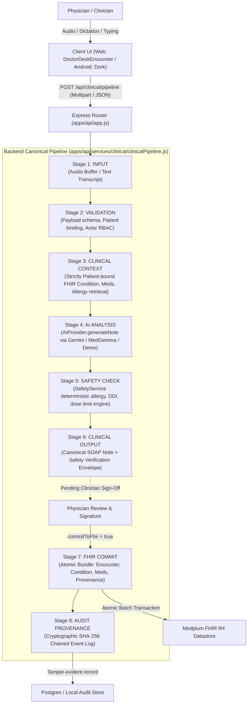

# PROTON EXISTING AI PIPELINE
**Ground-Truth End-to-End Clinical Flow Analysis**
*Milestone 0.5 Deliverable — Documenting the Actual Architecture as of 2026-10-18*

---

## 1. Executive Summary

This document describes the **actual, operational clinical AI pipeline** running in the Proton repository today. It does not reflect aspirational design; it reflects the real code executed across `apps/web`, `apps/dork-android`, `apps/api`, and `medplum-main`.

---

## 2. End-to-End Pipeline Architecture Map

---

## 3. Granular Stage-by-Stage Trace

### Stage 1: Input Ingestion
* **Location:** `apps/api/app.js` (`/api/clinical/pipeline` and `/api/clinical/pipeline/stream`)
* **Transport:** HTTP `POST` multipart/form-data (optional audio file) or JSON body.
* **Payload Components:**
  * `patientId` (required, e.g. `Patient/eleanor-vance` or `eleanor-vance`)
  * `practitionerId` (e.g. `Practitioner/dr-chen-01`)
  * `actor` (JWT / session actor: `{ actorId, actorRole, tenantId }`)
  * `transcript` (string dialogue text)
  * `audioBuffer` (raw PCM / WAV / MP3 / M4A audio buffer via Multer memory storage)
  * `audioMimeType` (e.g. `audio/wav`, `audio/m4a`)
  * `template` (`'SOAP'` or `'General Consultation'`)
  * `prescriptions` (array of proposed medications to safety check)
  * `confirmedPrescriptions` / `confirmedConditions` (explicit clinician-approved records for FHIR commit)
  * `commitToFhir` (boolean flag)
  * `physicianDirective` (string override rationale if contraindications are acknowledged)

### Stage 2: Validation
* **Location:** `ClinicalPipeline.prototype.validateInput()` in `clinicalPipeline.js`
* **Invariants Enforced:**
  * `patientId` must be non-empty and well-formed.
  * Either `transcript` or `audioBuffer` must be present (otherwise throws `ClinicalPipelineError(INPUT_INVALID)`).
  * If audio is provided, byte length must exceed 64 bytes and MIME type must belong to supported audio formats (delegated to `mediaService.validateAudioBuffer`).
  * Cross-tenant access probe validation: Verifies actor tenant matches target patient organization.

### Stage 3: Clinical Context Retrieval
* **Location:** `ClinicalPipeline.prototype.retrieveContext()` calling `fhirService.getPatientClinicalContext()`
* **Mechanism:**
  * Executes atomic parallel reads:
    * `Patient/<id>`
    * `Condition?patient=<id>`
    * `MedicationStatement?patient=<id>`
    * `AllergyIntolerance?patient=<id>`
    * `Encounter?patient=<id>`
  * Fails closed with `PATIENT_NOT_FOUND (404)` if patient record does not exist.
  * Checks tenant tag (`https://proton.health/tenant`); throws `CROSS_TENANT_ACCESS_DENIED (403)` on mismatch.
  * Binds intake questionnaire responses and acute imaging triage findings if available via `multimodalContextService`.

### Stage 4: AI Analysis & Clinical Synthesis
* **Location:** `ClinicalPipeline.prototype.generateClinicalNote()` calling `aiService.generateNote()`
* **Provider Invocation:**
  * Dispatches to active provider from `providers/factory.js` (`GeminiProvider`, `MedGemmaProvider`, or `DemoProvider`).
  * Enforces structured JSON output schema matching `SOAP_NOTE_SCHEMA` (`subjective`, `objective`, `assessment`, `plan`, `suggested_prescriptions`, `diagnoses`, `follow_up`).
  * Invariant: Zero silent mock fallback in live modes; if LLM times out or fails, raises explicit `AIProviderError` with HTTP 502/504.

### Stage 5: Deterministic Safety Check
* **Location:** `ClinicalPipeline.prototype.executeSafetyVerification()` calling `safetyService.verifyPrescriptions()`
* **Rules Executed:**
  * `ALLERGY_CONTRAINDICATIONS`: Cross-checks patient allergies against proposed drug classes (e.g., Penicillin $\rightarrow$ Amoxicillin hard-stop, Cephalosporin cross-reactivity warning).
  * `DRUG_DRUG_INTERACTIONS`: Intercepts high-risk combinations (Warfarin + NSAIDs, ACEi + ARB, DOAC renal clearance).
  * `DAILY_DOSE_LIMITS`: Validates dosage ceilings (e.g., Acetaminophen > 4000mg/day).
  * Completeness verification: Rejects prescriptions missing dose, route, frequency, or duration.
* **Gating Invariant:**
  * If a CRITICAL violation occurs:
    * If `physicianDirective` is provided by an authenticated `physician` role ($\ge 10$ characters rationale), pipeline continues with `DIRECTIVE_OVERRIDE` audit.
    * Otherwise, execution **strictly halts** with `CONTRAINDICATION_HARD_STOP` (HTTP 409). Non-physician roles (nurses, operations staff, AI agents) cannot issue overrides.

### Stage 6: Clinical Output Envelope
* **Location:** `ClinicalPipeline.prototype.assembleOutput()`
* **Structure:**
  * Structured SOAP note with explicit provenance: `AI DRAFT — REVIEW REQUIRED`.
  * Deterministic safety scorecard with violation list, warning list, and completeness metrics.
  * Extracted differential diagnosis candidates marked `unconfirmed`.

### Stage 7: Atomic FHIR Persistence
* **Location:** `ClinicalPipeline.prototype.persistFhirEncounter()` calling `fhirService.createTransactionBundle()`
* **Execution:**
  * Only executes if `commitToFhir === true` and explicit clinician confirmation is supplied.
  * Packages FHIR R4 resources into a single atomic transaction bundle:
    * `Encounter` (status: `finished`)
    * `ClinicalImpression` (capturing note narrative, template, and timestamp)
    * `Condition` (for confirmed diagnoses)
    * `MedicationRequest` (for confirmed, signed prescriptions)
    * `Provenance` (binding the practitioner identity, algorithm version, and timestamp)
  * Submits via `medplum.executeBatch` or `postgresAdapter.withTenantTransaction`.
  * If any resource fails validation, the entire bundle is rolled back with zero orphaned data.

### Stage 8: Tamper-Evident Audit Provenance
* **Location:** `auditService.recordPipelineStage()`
* **Mechanism:**
  * Every execution (both SUCCESS and FAILED) appends a SHA-256 hashed event.
  * Chains: `currentHash = SHA256(prevHash + timestamp + actorId + patientId + stage + status + payloadDigest)`.
  * Logs zero raw protected clinical text or patient chain-of-thought to prevent PHI leakage.

---

## 4. Trust Boundaries & Security Enforcements

1. **Client Trust Boundary:** The frontend is completely untrusted. Any client-supplied flags (e.g., `{ safetyStatus: 'VERIFIED' }`) are discarded; the backend deterministically re-runs all safety rules.
2. **Actor Role Hierarchy:**
   * `physician`: Full clinical authority, can sign notes, confirm conditions, approve prescriptions, and issue documented safety overrides.
   * `operations_staff`: Can confirm scheduling tasks and manage referrals; strictly forbidden from signing prescriptions or issuing clinical overrides.
   * `system` / `agent`: Autonomous execution of data retrieval and drafting; strictly forbidden from committing clinical actions.
3. **Tenant Compartment Isolation:** Database queries, document uploads, and audit records are partitioned by `tenantId`. Cross-tenant probes are rejected with HTTP 403.
