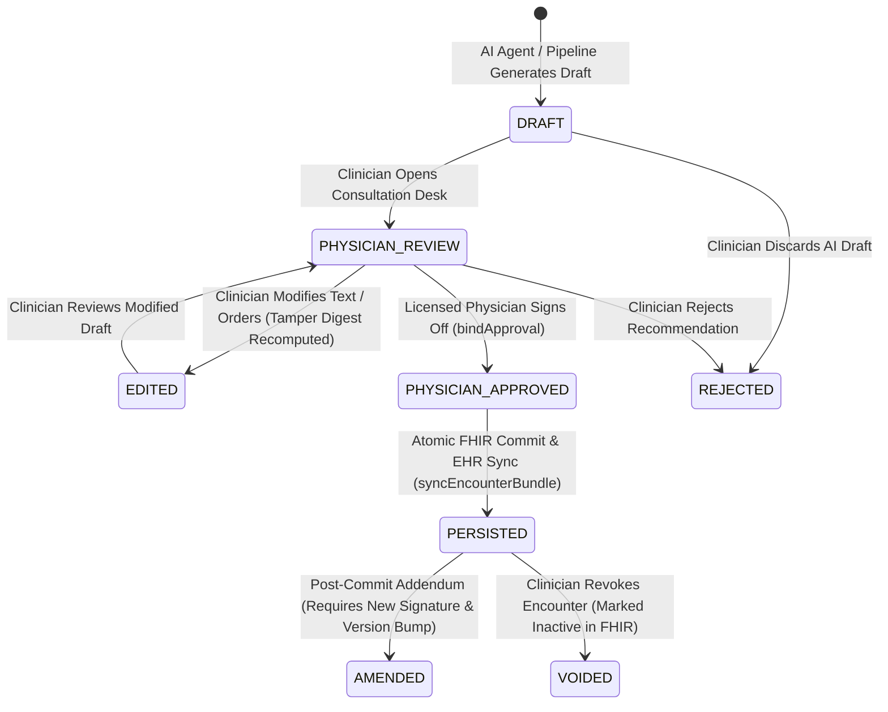

# PROTON MILESTONE 6 — CLINICAL INTEGRITY & APPROVAL BINDING SPECIFICATION

**Classification:** Clinical Governance & Architectural Specification  
**System:** Proton AI-Native Multi-Specialty Clinical Operating System  
**Milestone:** 6 — Production Hardening, Security, Reliability & Clinical Integrity  

---

## 1. Principle of Physician Authority

Proton strictly adheres to the non-negotiable invariant:
> **AI may draft, classify, summarize, predict, and assist; AI must NEVER silently become the final clinical authority.**

No clinical recommendation—whether an ambient scribe SOAP note, a specialist agent perspective, an OCR-extracted lab fact, an imaging triage score, or a suggested medication order—can become active clinical reality without explicit, authenticated review and signature by a licensed physician.

---

## 2. Clinical Artifact State Machine

Every clinical artifact generated or processed by Proton undergoes a strict, unidirectional lifecycle governed by the `ProvenanceSystem`:



### State Definitions & Enforced Constraints

| State | Who Can Transition | Cryptographic Invariant | Persistence Allowed? |
| :--- | :--- | :--- | :--- |
| **`DRAFT` / `AI_GENERATED`** | AI Agents, Pipeline, Scribe | Signed with `tamperHash` and `draftDigest`. Tagged with `https://proton.health/approval#DRAFT`. | **STRICTLY BLOCKED** (`UNAPPROVED_CLINICAL_PERSISTENCE_REJECTED`) |
| **`PHYSICIAN_REVIEW`** | Scribe, Clinician Desk | Artifact loaded in Doctor Desk; timer active; inline edits tracked. | **BLOCKED** |
| **`EDITED`** | Physician | Digest updated to match modified text; previous approval invalidated. | **BLOCKED** |
| **`REJECTED`** | Physician | Tagged `REJECTED`; recorded in audit log; permanently excluded from FHIR. | **BLOCKED** |
| **`PHYSICIAN_APPROVED` / `APPROVED`** | Licensed Physician ONLY | Signed with `boundApproval` containing artifact SHA-256 digest, patient ID, encounter version, and physician NPI. | **ALLOWED** |
| **`PERSISTED`** | FHIR Service | Transaction committed to FHIR store with verified approval binding and sequential version increment. | **COMMITTED** |
| **`AMENDED`** | Physician | Retains link to prior version; creates fresh approval envelope with addendum note. | **COMMITTED** (New Version) |
| **`VOIDED`** | Physician / Medical Director | Encounter marked entered-in-error with reason code and audit trail entry. | **STATUS UPDATED** |

---

## 3. Cryptographic Tamper-Binding (`bindApproval`)

To eliminate transit tampering, race conditions, or unauthorized background alterations between the moment a physician clicks "Approve" and the moment data is synced to Epic/Cerner, Proton enforces **cryptographic approval binding**:

### 3.1 Digest Computation
When a physician approves a note, prescription, or plan, `provenanceSystem.bindApproval` computes the SHA-256 digest of the canonical artifact:

$$\text{artifactDigest} = \text{SHA-256}(\text{JSON.stringify}(\text{clinicalArtifact}))$$

The resulting `boundApproval` block is attached to the provenance envelope:

```json
{
  "boundApproval": {
    "artifactDigest": "a4f89b1c2d3e4f5a...",
    "approvedVersion": 1,
    "patientId": "clara-davis",
    "encounterId": "enc-101",
    "approvedAt": "2026-10-18T10:45:37.725Z",
    "physicianId": "usr-md-lin-01",
    "physicianName": "Dr. Sarah Lin, MD"
  }
}
```

### 3.2 Pre-Sync Verification (`verifyApprovalBinding`)
During `fhirService.syncEncounterBundle`, the server verifies three invariants before writing a single byte to the database or EHR:

1. **Patient Invariant:** Current patient context must strictly match `boundApproval.patientId`.
2. **Version Invariant:** Current encounter version must strictly match `boundApproval.approvedVersion`. If the chart was updated concurrently by another practitioner, sync fails with HTTP 409 `ENCOUNTER_STALE`.
3. **Content Invariant:** Recomputing the SHA-256 digest of the artifact payload must match `boundApproval.artifactDigest`. If a medication dose, condition text, or allergy was altered post-approval, sync fails with `ARTIFACT_MODIFIED_AFTER_APPROVAL`.

---

## 4. Unapproved Persistence Defense

In `apps/api/services/fhir/fhirService.js`, the transaction bundle synchronizer iterates over every proposed FHIR resource in the transaction bundle. The entry is immediately rejected if:
- `res.isAiDraft === true`
- `res.verificationStatus === 'unconfirmed'`
- `res.status === 'ai_draft' || res.status === 'draft'`
- `res.meta.tag` contains `DRAFT` or `AI_GENERATED`
- `res.clinicalStatus.coding` contains `draft` or `unconfirmed`

Attempting to sync any such resource immediately aborts the transaction with HTTP 403:
```json
{
  "error": "UNAPPROVED_CLINICAL_PERSISTENCE_REJECTED",
  "message": "Clinical integrity violation: Attempted to persist unapproved AI draft Condition/cond-01 directly to FHIR. Explicit physician approval required.",
  "code": "UNAPPROVED_CLINICAL_PERSISTENCE_REJECTED"
}
```

---

## 5. Optimistic Concurrency Control

To prevent race conditions during multi-provider rounds:
- Every Encounter maintains a persistent sequential integer version in SQLite (`encounter_versions` table).
- When submitting an update via `/api/fhir/encounter/sync`, the client provides `expectedVersion`.
- If `serverVersion !== expectedVersion`, the transaction fails closed with HTTP 409 `ENCOUNTER_STALE`.
- On successful commit, the version increments atomically: $\text{version}_{t+1} = \text{version}_t + 1$.

---

## 6. Verification Evidence

The clinical integrity architecture is validated automatically in `apps/api/tests/milestone6_security.cjs`:
- **Test 4.1:** Persistence of unapproved AI draft rejected with HTTP 403 `UNAPPROVED_CLINICAL_PERSISTENCE_REJECTED` (PASS).
- **Test 4.2:** Tamper-binding cryptographically locks artifact; post-approval mutation detected as `ARTIFACT_MODIFIED_AFTER_APPROVAL` (PASS).
- **Test 4.3:** Stale encounter version conflict rejected with HTTP 409 `ENCOUNTER_STALE` (PASS).
- **Test 8.2:** Multi-resource transaction rollback verifies zero partial persistence on structural failure (PASS).
