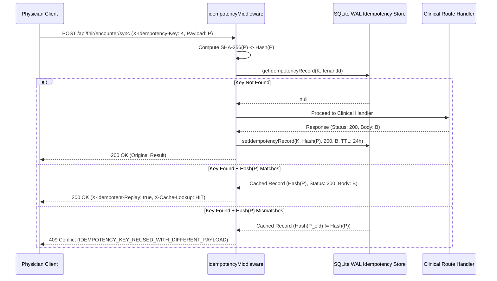

# PROTON MILESTONE 6 — NETWORK RESILIENCE & IDEMPOTENCY SPECIFICATION

**Classification:** Distributed Systems Architecture & Network Resilience Standard  
**System:** Proton AI-Native Multi-Specialty Clinical Operating System  
**Milestone:** 6 — Production Hardening, Security, Reliability & Clinical Integrity  

---

## 1. Network Resilience Objectives

Clinical environments frequently experience intermittent wireless connectivity (e.g., roaming on hospital Wi-Fi, tablet disconnections during patient transport). Without robust network resilience and idempotency controls:
- A network timeout during prescription order submission can lead a clinician to re-click "Approve", resulting in **duplicate medication orders**.
- Duplicate webhook deliveries from hospital EHR interfaces (Epic, Cerner) can trigger duplicate encounter creation or double billing.
- Transient upstream AI provider errors (e.g., HTTP 429 rate limits or HTTP 503 gateway drops) can prematurely abort active doctor consultations.

---

## 2. Idempotency Architecture (`idempotencyMiddleware`)

Proton implements a deterministic, durable idempotency layer mounted across all mutating clinical endpoints (`/api/fhir/encounter/bundle`, `/api/fhir/encounter/sync`, `/api/ai/approve`, `/api/clinical/confirm/*`).

### 2.1 Protocol Specification



### 2.2 Replay Header Contracts
- When a cached idempotent response is served, Proton sets:
  - `X-Idempotent-Replay: true`
  - `X-Cache-Lookup: HIT`
- When a client reuses an idempotency key with a modified payload, the server rejects the request immediately:
  - HTTP 409 Conflict
  - `{"error": "Idempotency key reused with different payload", "code": "IDEMPOTENCY_KEY_REUSED_WITH_DIFFERENT_PAYLOAD"}`

### 2.3 Durable Backing Store
In `apps/api/storage/idempotencyRepository.js`, idempotency keys are stored in a dedicated SQLite table running in Write-Ahead Logging (WAL) mode:
```sql
CREATE TABLE IF NOT EXISTS idempotency_keys (
  key TEXT PRIMARY KEY,
  tenant_id TEXT NOT NULL,
  payload_hash TEXT NOT NULL,
  response_status INTEGER NOT NULL,
  response_body TEXT NOT NULL,
  created_at TEXT NOT NULL,
  expires_at TEXT NOT NULL
);
```
- **TTL Retention:** 86,400 seconds (24 hours). Expired keys are automatically purged on lookup.
- **Server Restart Resilience:** Because keys are committed to disk via WAL transactions, server restarts or container redeployments preserve idempotency records.

---

## 3. Distributed Request & Trace Correlation

Every HTTP request entering the Proton API is assigned two immutable correlation identifiers:
1. `X-Request-Id`: Unique request identifier (`req-<uuid>`).
2. `X-Trace-Id`: Distributed trace identifier (`trace-<uuid>`).

If upstream gateways or clients pass an existing `X-Request-Id` or `X-Trace-Id`, Proton propagates the incoming identifier through downstream handlers, database writes, and telemetry logs.

Both headers are exposed via CORS (`exposedHeaders`) and returned on every HTTP response.

---

## 4. Capped Retries & Exponential Backoff

For transient upstream failures (HTTP 429 rate limits, HTTP 503 service unavailable, network socket drops), `executeProviderOperation` in `apps/api/app.js` executes capped retries:
- **Maximum Retries:** 2 attempts.
- **Backoff Strategy:** Jittered exponential backoff:
  $$\text{delayMs} = \text{attempt} \times 800\text{ms} + \text{random}(0, 400)\text{ms}$$
- **Non-Transient Failures:** Client errors (HTTP 400, HTTP 401, HTTP 403, HTTP 409) and schema validation errors fail immediately without retrying.

---

## 5. Rate Limiting Budgets

In-memory sliding window rate limiters protect the API against runaway scripts and denial-of-service attempts:
- **General Endpoints:** 500 requests / 60 seconds per IP/Actor (`RATE_LIMIT_EXCEEDED`).
- **AI Processing Endpoints (`/api/transcribe`, `/api/generate-note`, `/api/chat`):** 60 requests / 60 seconds per IP/Actor (`AI_RATE_LIMIT_EXCEEDED`).
- Returns `Retry-After` header specifying remaining window cooldown in seconds.

---

## 6. Verification Evidence

Validated in `apps/api/tests/milestone6_security.cjs`:
- **Test 7.1:** Duplicate request with same key returns cached response with `X-Idempotent-Replay: true` and `X-Cache-Lookup: HIT` (PASS).
- **Test 7.2:** Reusing idempotency key with conflicting payload rejected with HTTP 409 `IDEMPOTENCY_KEY_REUSED_WITH_DIFFERENT_PAYLOAD` (PASS).
- **Test 9.1:** Distributed trace headers `X-Request-Id` and `X-Trace-Id` propagated and returned on every response (PASS).
