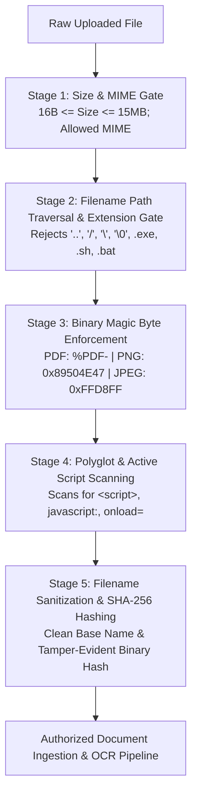

# PROTON MILESTONE 6 — UPLOAD & DOCUMENT SECURITY SPECIFICATION

**Classification:** Infrastructure Security & Input Validation Standard  
**System:** Proton AI-Native Multi-Specialty Clinical Operating System  
**Milestone:** 6 — Production Hardening, Security, Reliability & Clinical Integrity  

---

## 1. Overview & Security Objectives

Proton ingests patient clinical documents (PDF discharge summaries, laboratory reports, referral letters, and wound/radiology images) for OCR analysis, structured fact extraction, and longitudinal timeline integration.

Because document ingestion involves parsing binary files from external clinics, hospital systems, and patients, the ingestion pipeline represents a critical boundary. The upload security architecture ensures that:
1. No executable binaries or scripts can be uploaded or executed on Proton servers.
2. No path traversal attacks can escape the upload boundaries or compromise the underlying host filesystem.
3. Content spoofing (disguising executable files with PDF extensions) is prevented via binary magic byte verification.
4. Polyglot attacks containing embedded HTML or JavaScript payloads are strictly quarantined and rejected.

---

## 2. Ingestion Defense Pipeline

Every document uploaded to Proton passes through a 5-stage validation gate in `apps/api/services/document/documentService.js`:



---

## 3. Defense Implementation Details

### 3.1 Path Traversal Defense
Filename inspection verifies that no directory traversal sequences exist in the uploaded filename:
```javascript
if (filename.includes('..') || filename.includes('/') || filename.includes('\\') || filename.includes('\0')) {
  throw new DocumentServiceError(
    'PATH_TRAVERSAL_DETECTED',
    'Filename contains prohibited path traversal sequences.',
    400
  );
}
```

### 3.2 Executable Content Proscription
Blacklisted extensions are rejected regardless of casing:
- `.exe`, `.bat`, `.cmd`, `.sh`, `.php`, `.pl`, `.py`, `.js`, `.vbs`, `.scr`, `.msi`, `.dll`, `.com`

```javascript
const dangerousExtensions = ['.exe', '.bat', '.cmd', '.sh', '.php', '.pl', '.py', '.js', '.vbs', '.scr', '.msi', '.dll', '.com'];
for (const ext of dangerousExtensions) {
  if (lowerName.endsWith(ext)) {
    throw new DocumentServiceError(
      'EXECUTABLE_CONTENT_PROHIBITED',
      `Executable file extension '${ext}' is strictly prohibited.`,
      400
    );
  }
}
```

### 3.3 Binary Magic Byte Verification
MIME types declared in HTTP headers are untrusted. Proton validates the initial bytes of the binary buffer:

| MIME Type | Expected Magic Signature | Offset | Failure Error |
| :--- | :--- | :--- | :--- |
| `application/pdf` | ASCII `%PDF-` (`0x25 0x50 0x44 0x46 0x2D`) | 0..4 | `INVALID_BINARY_FORMAT` |
| `image/png` | `0x89 0x50 0x4E 0x47` | 0..3 | `INVALID_BINARY_FORMAT` |
| `image/jpeg` / `jpg` | `0xFF 0xD8 0xFF` (SOI Marker) | 0..2 | `INVALID_BINARY_FORMAT` |

### 3.4 Polyglot & Script Injection Protection
Documents containing embedded active content (e.g., SVG/HTML polyglots with JavaScript payloads) are scanned in the first 4096 bytes:
```javascript
const textPreview = buffer.slice(0, 4096).toString('utf8').toLowerCase();
if (textPreview.includes('<script') || textPreview.includes('javascript:') || textPreview.includes('<svg/onload') || textPreview.includes('onload=')) {
  throw new DocumentServiceError(
    'MALICIOUS_SCRIPT_DETECTED',
    'Embedded executable scripts or active HTML injection in clinical documents are strictly prohibited.',
    400
  );
}
```

### 3.5 Filename Sanitization
Filenames stored in metadata are stripped of non-alphanumeric characters:
```javascript
sanitizeFilename(rawFilename) {
  if (!rawFilename || typeof rawFilename !== 'string') return 'document';
  const base = path.basename(rawFilename);
  return base.replace(/[^a-zA-Z0-9._-]/g, '_').slice(0, 100);
}
```

---

## 4. Verification Evidence

Validated in `apps/api/tests/milestone6_security.cjs`:
- **Test 6.1:** Path traversal filename (`../../etc/passwd`) rejected with `PATH_TRAVERSAL_DETECTED` (PASS).
- **Test 6.2:** Executable file extension (`medical_report.pdf.exe`) rejected with `EXECUTABLE_CONTENT_PROHIBITED` (PASS).
- **Test 6.3:** Non-PDF binary disguised with PDF extension rejected with `INVALID_BINARY_FORMAT` (PASS).
- **Test 6.4:** Polyglot script injection (`<script>alert(1)</script>`) rejected with `MALICIOUS_SCRIPT_DETECTED` (PASS).
