# Proton Milestone 2A — Dynamic Clinical Intake & Safety Gate

## Executive Summary

Milestone 2A establishes Proton's **FHIR R4-native dynamic clinical intake architecture**. This milestone empowers patients to report symptoms, onset, anatomical location, and severity through adaptive, branching questionnaires while upholding Proton's core clinical invariants:
1. **Physician Authority Invariant**: Patient-reported intake data is strictly recorded as subjective evidence (`source = 'patient_reported'`) with FHIR `status: 'preliminary'`, category `survey`, and bound to FHIR `Provenance`. It is **never** autonomously converted into active, confirmed FHIR `Condition` or `MedicationRequest` resources without explicit clinician encounter verification and sign-off.
2. **Deterministic Pre-AI Safety Gate**: High-risk presentations (anaphylaxis, acute respiratory distress, severe pain $\ge 8/10$, rapid lesion progression) are evaluated **deterministically** before LLM invocation, immediately classifying the presentation as `EMERGENCY` or `URGENT` and preventing clinical red flags from being obscured or diluted by AI summarization.
3. **Multi-Tenant & Patient Isolation**: Strict server-side validation guarantees that authenticated patients can only submit intake data for their own patient identity (`HTTP 403` on cross-patient or cross-tenant attempts).

---

## Architecture Overview

```mermaid
flowchart TD
    subgraph PatientExperience["Patient Experience Layer"]
        A["Patient Initiates Intake"] --> B["DynamicIntake UI Component"]
        B --> C["QuestionRenderer & Branching Engine (Client-side)"]
        C --> D["Submit Answers to /api/intake/questionnaires/:id/responses"]
    end

    subgraph BackendIntake["Backend Intake Hub"]
        D --> E["ResponseValidator (Schema, Types, Patient & Tenant Scope)"]
        E --> F["Deterministic EscalationEngine (Pre-AI Red-Flag Gate)"]
        F --> G["ContextMapper (FHIR R4 QR, Survey Observation, Provenance)"]
        G --> H["Atomic FHIR Bundle Persistence (Medplum/Adapter)"]
        G --> I["Cryptographic Audit Trail (SHA-256 Chained Logging)"]
    end

    subgraph ClinicianDesk["Physician Desk & Clinical Pipeline"]
        H --> J["DoctorDeskEncounter (Intake Tab & Review)"]
        F --> K["Canonical Clinical Pipeline (Intake Context Injected)"]
        K --> L["AI Clinical Analysis (Strictly Unconfirmed Differential)"]
        L --> M["Physician Evaluates & Confirms Diagnoses/Orders"]
    end
```

---

## 1. FHIR R4 Questionnaire Architecture

### Questionnaire Catalog (`apps/api/services/intake/questionnaireCatalog.js`)
Proton implements standardized, extensible FHIR R4 `Questionnaire` definitions:
* **`questionnaire-derm-intake-v1`**: Dermatology and skin presentations (concern, onset, location, pruritus, itch severity, pain, pain severity 1-10, rapid spread, and systemic red flags).
* **`questionnaire-resp-intake-v1`**: Respiratory complaints (cough character, duration, sputum, fever, dyspnea at rest, hemoptysis, and oxygenation warning signs).
* **`questionnaire-general-v1`**: General primary care intake (chief complaint, duration, systemic review, functional impact).

### FHIR R4 Resources Created Per Intake Submission
1. **`QuestionnaireResponse`**:
   - Holds structured patient responses grouped by `linkId`.
   - `status`: `'completed'`
   - `meta.tag`: `[{ system: 'https://proton.health/source', code: 'patient_reported' }]`
2. **`Observation` (Preliminary Survey Observation)**:
   - `status`: `'preliminary'` (explicitly non-authoritative)
   - `category`: `[{ coding: [{ system: 'http://terminology.hl7.org/CodeSystem/observation-category', code: 'survey' }] }]`
   - `valueString`: Formatted clinical narrative with `[PATIENT-REPORTED INTAKE]` header.
3. **`Provenance`**:
   - Cryptographically binds the `QuestionnaireResponse` and `Observation`.
   - Records agent: `Patient/<patientId>` (`role: informant`).
   - Targets: `[QuestionnaireResponse/<id>, Observation/<id>]`.

---

## 2. Dynamic Branching Engine (`branchingEngine.js`)

The dynamic branching engine evaluates FHIR R4 `enableWhen` conditions deterministically:
* **Operators Supported**: `=`, `!=`, `>`, `<`, `>=`, `<=`, `exists`.
* **Behavior Policies**:
  - `enableBehavior: 'all'` (conjunction / AND, default)
  - `enableBehavior: 'any'` (disjunction / OR)
* **Real-time UI & Server Parity**: Evaluated both dynamically on the client inside `QuestionRenderer` / `DynamicIntake` and strictly validated server-side in `responseValidator.js`.

---

## 3. Deterministic Pre-AI Red-Flag Escalation (`escalationEngine.js`)

High-risk presentations trigger an immediate deterministic escalation before any generative AI processing:

| Domain | Trigger Condition | Severity | Triage Classification | Clinical Action |
| :--- | :--- | :--- | :--- | :--- |
| **Dermatology** | `systemic_red_flags: true` (fever, dyspnea, mucosal involvement) | CRITICAL | **`EMERGENCY`** | Immediate ED evaluation / 911 alert |
| **Dermatology** | `pain_severity >= 8` OR `rapid_spread: true` | HIGH | **`URGENT`** | Same-day urgent physician review |
| **Respiratory** | `dyspnea_rest: true` OR `hemoptysis: true` | CRITICAL | **`EMERGENCY`** | Immediate emergency escalation |
| **Respiratory** | `fever: true` AND `duration >= 7 days` | HIGH | **`URGENT`** | Priority clinician assessment |

---

## 4. Physician Authority & Clinical Pipeline Safety

Intake data flows safely into the canonical 8-stage clinical pipeline:
1. **Input Stage**: Ingests `intakeContext` alongside audio/transcript.
2. **Pre-AI Triage**: Stage `INTAKE_RED_FLAG_ESCALATION` audits emergency red flags.
3. **AI Context Injection**: Injected narrative is explicitly labeled `[PATIENT-REPORTED INTAKE]`.
4. **Differential Diagnosis Status**: All AI diagnoses and differentials are output with `clinicianConfirmed: false`.
5. **No Autonomous Conditions**: The intake system and AI pipeline **never** commit active FHIR `Condition` or `MedicationRequest` resources without explicit clinician sign-off during the encounter.

---

## 5. Frontend Implementation

* **`DynamicIntake.tsx`**: Patient-facing intake flow with step-by-step navigation, real-time FHIR branching, progress tracking, and validation guards.
* **`QuestionRenderer.tsx`**: Renders choice cards, integer severity sliders (1-10), toggle buttons, and text fields with accessible keyboards.
* **`IntakeProgress.tsx`**: Visual stepped indicator showing current progress through active dynamic questions.
* **`IntakeReview.tsx`**: Clinician-facing desk component featuring:
  - Clear `[Patient-Reported]` badges on every fact.
  - Triage escalation alert banners (Emergency / Urgent vs Routine).
  - Explicit visual separation between patient observations and AI suggestions.
* **`DoctorDeskEncounter.tsx`**: Integrated 4th tab (`Patient Intake (FHIR)`) and keyboard shortcut (`⌘4` / `Ctrl+4`).

---

## 6. Test & Validation Scorecard

All 18 Milestone 2A automated tests passed (100%):

| # | Test Scenario | Category | Status |
| :-: | :--- | :--- | :-: |
| 1 | Questionnaire loads by ID | FHIR Catalog | ✓ PASS |
| 2 | Questionnaire schema adheres to FHIR R4 | FHIR Catalog | ✓ PASS |
| 3 | Required question enforcement rejects missing answers | Validation | ✓ PASS |
| 4 | Answer type validation rejects mismatched types | Validation | ✓ PASS |
| 5 | Invalid choice option rejected | Validation | ✓ PASS |
| 6 | Conditional question hidden when condition is false | Branching Engine | ✓ PASS |
| 7 | Conditional question shown when condition is true | Branching Engine | ✓ PASS |
| 8 | Malformed response payload rejected | Validation | ✓ PASS |
| 9 | Cross-patient response rejected with HTTP 403 | Security Isolation | ✓ PASS |
| 10 | Cross-tenant response rejected | Security Isolation | ✓ PASS |
| 11 | Patient-reported source preserved in FHIR Observation (`status: preliminary`) | FHIR Integrity | ✓ PASS |
| 12 | FHIR Provenance resource created and linked | FHIR Integrity | ✓ PASS |
| 13 | AI clinical pipeline processes intake with unconfirmed differential | Physician Authority | ✓ PASS |
| 14 | No direct AI-created active Condition | Physician Authority | ✓ PASS |
| 15 | No direct AI-created active MedicationRequest | Physician Authority | ✓ PASS |
| 16 | Deterministic escalation hook triggers immediate emergency triage | Red-Flag Safety | ✓ PASS |
| 17 | Cryptographic audit event created for intake questionnaire submission | Audit Trail | ✓ PASS |
| 18 | Milestone 1 tests remain passing (Zero regression) | Regression | ✓ PASS |

---

## 7. Zero-Regression Verification

All previous validation suites executed with zero regressions:
* **Milestone 1 Architecture Validation**: 17/17 passed (100%)
* **Milestone 1 Clinical Integrity & Safety Validation**: 14/14 passed (100%)
* **Clinical AI Validation (Live Gemini Engine)**: All 10 parts passed (GO for Controlled Beta)
* **Web Application (`apps/web`)**: TypeScript `tsc -b` and Vite production build passed cleanly.
