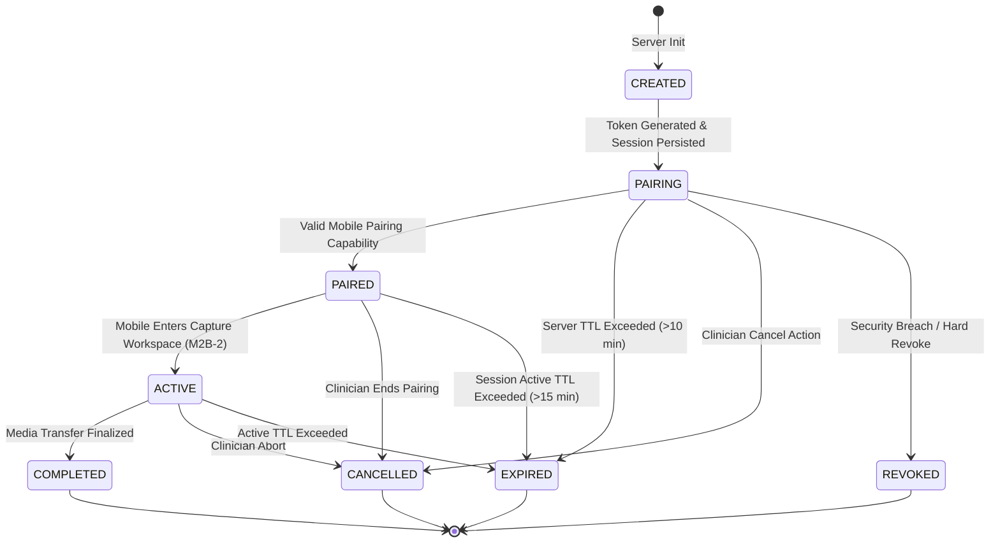

# Proton V2 Milestone 2B-1: Secure Cross-Device Capture Sessions Architecture

**Status:** Implemented & Verified  
**Milestone:** M2B-1 (Secure Desktop $\leftrightarrow$ Mobile Pairing Foundation)  
**Security Level:** Production-Grade Trust Boundary

---

## 1. Executive Summary

Milestone 2B-1 establishes the foundation for cross-device multimodal capture in Proton. It enables a clinician on the Proton desktop application to initiate a short-lived, cryptographically secure capture session that can be paired with a patient's mobile smartphone via an opaque QR code.

> [!IMPORTANT]
> **Pure Capability Invariant:**  
> The capture session is strictly an authentication and authorization capability mechanism. It establishes an ephemeral channel between a specific encounter and a physical device. **It does NOT perform, authorize, or imply clinical diagnosis, image interpretation, observation creation, or autonomous ordering.**

---

## 2. Threat Model & Security Boundaries

Cross-device healthcare pairing introduces unique threat vectors that this architecture explicitly addresses:

```
+---------------------------------------------------------------------------------------+
|                                     THREAT MATRIX                                      |
+--------------------------+------------------------------+-----------------------------+
| Threat Vector            | Vulnerability Scenario       | Proton M2B-1 Mitigation    |
+--------------------------+------------------------------+-----------------------------+
| QR Payload Eavesdropping | Bystander snaps QR photo     | Opaque 256-bit capability   |
|                          |                              | ZERO patient/clinical data  |
+--------------------------+------------------------------+-----------------------------+
| Token Replay Attack      | Attacker intercepts token    | Single-use pairing consumed |
|                          | and attempts second pairing  | atomically on first pair    |
+--------------------------+------------------------------+-----------------------------+
| Session Tampering        | Attacker changes patient ID  | Server state is authoritative|
|                          | or encounter ID on session   | Client cannot mutate context|
+--------------------------+------------------------------+-----------------------------+
| Cross-Tenant Leakage     | User from Org B accesses     | Strict tenant isolation on  |
|                          | capture session from Org A   | all lookups & actions (403) |
+--------------------------+------------------------------+-----------------------------+
| Abandoned QR Abandonment | Clinician leaves desk with   | Server-enforced 10-min TTL  |
|                          | QR displayed on screen       | Auto-transitions to EXPIRED |
+--------------------------+------------------------------+-----------------------------+
| Timing Attacks           | Comparison timing leaks bits | crypto.timingSafeEqual on   |
|                          | of token hash                | buffer comparison           |
+--------------------------+------------------------------+-----------------------------+
| Audit Log Leakage        | Raw token leaked into audit  | Raw tokens NEVER logged;    |
|                          | trail or error logs          | only sanitized hash prefix  |
+--------------------------+------------------------------+-----------------------------+
```

---

## 3. Capture Session State Machine

The session lifecycle is server-authoritative and deterministic. The client is strictly prohibited from arbitrarily asserting or mutating session status.



### State Definitions:
1. `CREATED`: Internal transient initialization state.
2. `PAIRING`: Desktop has generated QR code; waiting for mobile device to scan and present pairing token.
3. `PAIRED`: Mobile device presented valid, unexpired, single-use token. Pairing capability consumed; mobile capability token issued.
4. `ACTIVE`: Mobile client actively engaged in capture workspace.
5. `COMPLETED`: Multimodal capture session successfully finished and closed.
6. `EXPIRED`: Terminal state triggered when server-side TTL elapses.
7. `CANCELLED`: Terminal state initiated by desktop clinician sign-off or cancellation.
8. `REVOKED`: Terminal state initiated by security violation or administrative override.

---

## 4. Secure Token Design & Cryptography

```
                    Raw Random Token (256-bit Entropy)
                       crypto.randomBytes(32)
                                 │
           ┌─────────────────────┴─────────────────────┐
           ▼                                           ▼
     Delivered to                                SHA-256 Hashing
   Desktop Client Once                     crypto.createHash('sha256')
 (Used ONLY for QR payload)                            │
           │                                           ▼
           ▼                                    Stored in SQLite
   Never stored on server                     capture_sessions table
   Never logged in audit                     (Raw token NEVER saved)
```

1. **Entropy:** Generated using Node's cryptographically secure random number generator (`crypto.randomBytes(32)`), yielding 64 hexadecimal characters (256 bits of entropy).
2. **Opacity:** The pairing token contains no delimiters, no base64-encoded JSON, and no JWT claims. It is an unguessable capability.
3. **Storage Security:** The database stores `pairing_token_hash = SHA256(rawToken)`. Even if the database is extracted, raw pairing tokens cannot be recovered.
4. **Timing Attack Resistance:** Token matching during pairing uses `crypto.timingSafeEqual` between the SHA-256 hash of the presented token and the stored hash.

---

## 5. Session Binding & Authoritative Identity

When a capture session is created via `POST /api/capture/sessions`:
- **Tenant Binding:** Determined strictly from `req.actor.tenantId`. Client-supplied tenant fields are discarded.
- **Actor Binding:** Session records `actorId`, `actorRole`, and `actorName` from the verified clinician session.
- **Patient Binding:** Session is strictly attached to `patientId` (e.g., `Patient/pat-123`). The patient must be accessible within the actor's tenant.
- **Encounter Binding:** Attached to the active encounter ID.

Any subsequent request to change patient, encounter, or tenant is rejected, preserving complete clinical provenance.

---

## 6. QR Code Representation & Payload Design

The QR code rendered on the desktop contains:
```
proton://capture/pair?token=<64-char-hex-token>&sess=<session-id>
```
Or an equivalent HTTPS deep link.

### Zero-PHI Invariant:
The QR code contains:
- $\times$ NO `patientId`
- $\times$ NO `patientName`
- $\times$ NO `dob` / `mrn`
- $\times$ NO `tenantId`
- $\times$ NO diagnoses, chief complaints, or clinical data

The mobile phone scanning the QR code gains access only to the pairing capability, not to patient records.

---

## 7. Replay Protection & Server-Side TTL

1. **Single-Use Capability:**
   Upon pairing, the database executes an atomic update:
   ```sql
   UPDATE capture_sessions
   SET status = 'PAIRED',
       pairing_token_consumed = 1,
       paired_at = ?
   WHERE id = ? AND pairing_token_consumed = 0 AND status = 'PAIRING';
   ```
   If a duplicate pairing attempt occurs with the same token, the database update returns 0 affected rows, and the API throws `HTTP 409 (SESSION_ALREADY_PAIRED)`.

2. **Server-Side Expiration:**
   - Default pairing TTL: 10 minutes (`600,000 ms`).
   - Every read (`getSessionById`, `pairSession`, `cancelSession`) checks `Date.now() > expiresAt`.
   - Expired sessions automatically transition to `EXPIRED` in the database and reject pairings with `HTTP 410 (SESSION_EXPIRED)`.

---

## 8. Tamper-Evident Cryptographic Audit Trail

All session lifecycle events are immutably logged into Proton's SHA-256 hash-chained operational audit trail:

- `CAPTURE_SESSION_CREATED`: Session generated with initial TTL.
- `CAPTURE_PAIRING_SUCCEEDED`: Device paired successfully.
- `CAPTURE_PAIRING_FAILED`: Invalid token, replay, or non-existent session.
- `CAPTURE_SESSION_EXPIRED`: Pairing attempted after TTL expiration.
- `CAPTURE_SESSION_CANCELLED`: Session cancelled by clinician.
- `CAPTURE_UNAUTHORIZED_ACCESS_ATTEMPT`: Cross-tenant inspection blocked.

**Audit Sanitization:** Raw tokens never appear in audit strings. Hashes are logged only as sanitized prefixes (e.g. `hash:a1b2c3d4...ef01`).

---

## 9. API Specification

| Method | Endpoint | Auth Required | Purpose | Response |
| :--- | :--- | :--- | :--- | :--- |
| `POST` | `/api/capture/sessions` | Clinician Bearer / Actor | Initialize capture session & QR | `201 Created`: `{ sessionId, pairingToken, expiresAt, status: 'PAIRING', qrPayload }` |
| `POST` | `/api/capture/sessions/:id/pair` | Pairing Capability Token | Mobile device pairs with session | `200 OK`: `{ success: true, sessionId, status: 'PAIRED', mobileToken, expiresAt }` |
| `GET` | `/api/capture/sessions/:id` | Clinician Bearer / Actor | Desktop status polling | `200 OK`: `{ sessionId, status, patientId, encounterId, createdAt, expiresAt, pairedAt }` |
| `POST` | `/api/capture/sessions/:id/cancel` | Clinician Bearer / Actor | Desktop clinician cancels session | `200 OK`: `{ success: true, sessionId, status: 'CANCELLED' }` |

---

## 10. Known Limitations & Next Steps

1. **Active Real-Time Transport (Milestone 2B-2):**
   Desktop polling currently uses a 2-second interval. In upcoming milestones, server-sent events (SSE) or WebSockets will provide sub-second push updates for mobile pairing state changes.
2. **Camera & Multimodal Ingestion (Milestone 2B-2):**
   Milestone 2B-1 provides solely the secure device-to-encounter pairing capability. Media capture, encrypted chunk uploads, and client-side camera handling will be implemented in subsequent phases.
