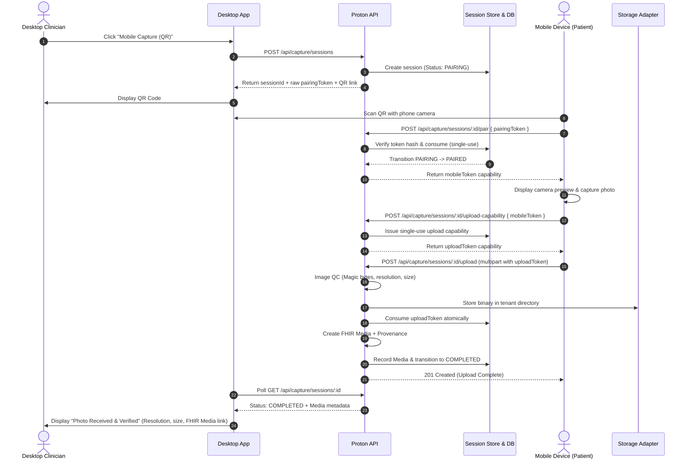

# Proton V2 Milestone 2B-2: Camera & Secure Image Upload Architecture

**Status:** Completed & Validated  
**Milestone:** M2B-2 (Mobile Camera Capture, Ingestion QC, and Secure Upload)  
**Security Level:** Multi-Tenant Medical Grade

---

## 1. Executive Summary

Milestone 2B-2 expands on the M2B-1 pairing foundation by introducing:
1. **A dedicated mobile capture application** (`/capture`) for patients or staff scanning the desktop pairing QR code.
2. **Deterministic image quality control (QC)** that verifies image dimensions, headers, magic bytes, and file size limits without diagnostic hallucinations.
3. **A decoupled storage abstraction layer** (`StorageAdapter`, `LocalStorageAdapter`) that provides path-traversal-proof, tenant-isolated persistence.
4. **Scoped single-use upload capabilities** preventing replay, credential reuse, or cross-session tampering.
5. **FHIR R4 Media and Provenance resource creation**, linking captured artifacts to the active patient and encounter while preserving the Milestone 1 physician authority model.

> [!IMPORTANT]
> **No Automated Diagnostic Interpretation:**  
> In accordance with clinical safety principles, Milestone 2B-2 strictly treats uploaded images as raw patient/device-captured media. It **does NOT** invoke AI vision models, diagnose conditions, suggest treatments, or persist active FHIR `Condition`, `MedicationRequest`, or `DiagnosticReport` resources.

---

## 2. Complete Cross-Device Architecture & Flow



---

## 3. Storage Abstraction Architecture

To avoid coupling clinical logic to local filesystem persistence, Milestone 2B-2 implements a clean storage abstraction:

```
apps/api/services/storage/
├── storageAdapter.js       # Abstract contract (store, retrieve, exists, delete)
├── localStorageAdapter.js   # Local filesystem implementation with path traversal defense
└── index.js                # Singleton factory
```

### Storage Security Controls:
1. **Path Traversal Sanitization:** All tenant IDs, session IDs, and media IDs are strictly validated. Any sequence containing `..`, `/`, `\`, or null bytes `\0` immediately throws a security violation.
2. **Directory Isolation:** Files are partitioned by tenant: `apps/api/data/uploads/<tenantId>/<mediaId>.<ext>`.
3. **Integrity Checksums:** SHA-256 cryptographic hashes are computed on ingestion and stored alongside companion metadata (`<mediaId>.meta.json`).

---

## 4. Deterministic Image Quality Control (QC)

Rather than passing raw, uninspected files directly to storage, all uploads pass through `ImageQualityValidator`:

* **Supported MIME Types:** `image/jpeg`, `image/jpg`, `image/png`, `image/webp`.
* **File Size Limits:** Minimum 1,024 bytes (1 KB) to prevent zero-byte corruptions; Maximum 15,728,640 bytes (15 MB).
* **Anti-Spoofing Magic Bytes:** Verifies file signature directly against binary headers:
  - JPEG: `0xFF 0xD8 0xFF`
  - PNG: `0x89 0x50 0x4E 0x47 0x0D 0x0A 0x1A 0x0A`
  - WEBP: `RIFF .... WEBP`
* **Resolution Bounds:** Header parsing extracts true image dimensions:
  - Minimum Resolution: $200 \times 200\text{ px}$ (ensures clinical legibility).
  - Maximum Resolution: $8192 \times 8192\text{ px}$.
* **Structured Errors:** Rejections return structured error codes: `IMAGE_TYPE_INVALID`, `IMAGE_TOO_LARGE`, `IMAGE_TOO_SMALL`, `IMAGE_CORRUPT`, `MIME_SPOOFING_DETECTED`, `IMAGE_QUALITY_REJECTED`.

---

## 5. Upload Capability Model

The original M2B-1 pairing token is **never reused** for uploads. Instead, a secondary upload capability is generated:

1. **Separation of Concerns:** Pairing token authenticates the device; upload token authorizes a single media submission.
2. **Single-Use Enforcement:** The database updates `consumed = 1` atomically on upload. Repeated upload attempts are rejected with `HTTP 409 (UPLOAD_CAPABILITY_ALREADY_USED)`.
3. **Session Scoping:** Capabilities are strictly tied to `session_id`. Tokens from one session cannot be uploaded to another.
4. **Short TTL:** Upload tokens expire after 15 minutes.

---

## 6. FHIR R4 Ingestion & Clinical Invariants

Upon successful upload, Proton generates standard FHIR R4 resources:

### A. FHIR Media (`Media`)
```json
{
  "resourceType": "Media",
  "id": "med-1734567890-abcd1234",
  "status": "completed",
  "type": {
    "coding": [{
      "system": "http://terminology.hl7.org/CodeSystem/media-type",
      "code": "image",
      "display": "Image"
    }]
  },
  "subject": { "reference": "Patient/pat-derma-101" },
  "encounter": { "reference": "Encounter/enc-derma-202" },
  "createdDateTime": "2026-10-17T04:45:00.000Z",
  "width": 1920,
  "height": 1080,
  "content": {
    "contentType": "image/jpeg",
    "size": 348291,
    "title": "Clinical Mobile Capture (1920x1080)"
  },
  "note": [{ "text": "Raw mobile device capture via secure pairing session (no AI interpretation)" }],
  "meta": { "tag": [{ "system": "https://proton.health/tenant", "code": "org-default" }] }
}
```

### B. FHIR Provenance (`Provenance`)
```json
{
  "resourceType": "Provenance",
  "id": "prov-1734567890-ef012345",
  "target": [{ "reference": "Media/med-1734567890-abcd1234" }],
  "recorded": "2026-10-17T04:45:00.000Z",
  "agent": [{
    "type": { "coding": [{ "system": "http://terminology.hl7.org/CodeSystem/provenance-participant-type", "code": "performer" }] },
    "who": { "reference": "Device/mobile-capture-client" }
  }],
  "entity": [{
    "role": "source",
    "what": { "reference": "CaptureSession/cap-sess-1734567890-abcdef123456" }
  }]
}
```

---

## 7. Tamper-Evident Audit Trail

All actions generate cryptographically chained SHA-256 audit events:

* `CAPTURE_UPLOAD_CAPABILITY_ISSUED`
* `CAPTURE_IMAGE_QC_ACCEPTED`
* `CAPTURE_IMAGE_QC_REJECTED`
* `CAPTURE_UPLOAD_SUCCEEDED`
* `CAPTURE_MEDIA_PERSISTED`
* `CAPTURE_INVALID_UPLOAD_CAPABILITY`
* `CAPTURE_REPLAY_REJECTED`

**Zero-Leakage Guarantee:** Raw upload capability tokens and binary image payloads are never written to audit records.

---

## 8. Verification & Test Coverage

The milestone includes 30 automated integration and security tests in `milestone2b2_camera_upload_validation.cjs`, verifying:
- Image QC bounds and anti-spoofing (Tests 1–6, 20)
- Capability issuance, opacity, and replay protection (Tests 7–13)
- Context isolation (Tests 14–19)
- FHIR integrity and physician authority guards (Tests 21–26)
- Audit trail integrity without leaks (Tests 27–30)
