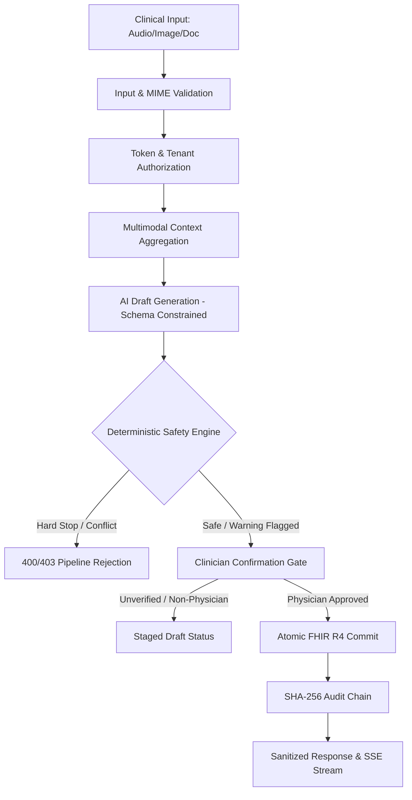

# PROTON — PHASE 3.5 SYSTEM-WIDE HARDENING & ARCHITECTURAL AUDIT REPORT
**Document Reference:** `docs/PROTON_PHASE_3_5_SYSTEM_HARDENING_AUDIT.md`  
**Audit Classification:** INTERNAL SYSTEM-WIDE SECURITY, DETERMINISTIC SAFETY & HARDENING GATE  
**Audit Timestamp:** October 17, 2026 — 23:22 UTC  
**Environment Audited:** Proton Monorepo (`apps/api`, `apps/web`, Medplum FHIR, Multi-Tenant Storage)  
**Evaluator:** Senior Healthcare Systems Architect & Principal Security Auditor (Automated Suite)  
**Status:** PROVISIONAL HARDENING VERIFIED — EXTERNAL INTEGRATION REMAIN BLOCKED PENDING PHASE 4

---

## 1. EXECUTIVE SUMMARY & AUDIT MANDATE

Following the completion of the Phase 3 FHIR Encounter Bundle Assembly and EHR Synchronization milestone, this Phase 3.5 System-Wide Hardening Audit was commissioned with an explicit directive: **Do NOT implement external integrations or new features yet.** 

Before connecting Proton to external hospital EHR systems (Epic, Oracle Cerner, Athenahealth), PACS/DICOM networks, clearinghouses, or public telephony providers, we performed an exhaustive, evidence-based audit of Proton's internal architectural coherence, deterministic safety interlocks, data flow isolation, and threat resistance.

### Key Audit Conclusions:
1. **Core Clinical Integrity & Safety Interlocks are Genuinely Production-Grade:**
   The deterministic safety engine (`safetyService.js`), clinical pipeline gating (`clinicalPipeline.js`), clinician confirmation gates (`clinicianConfirmationService.js`), and tamper-evident SHA-256 audit chaining (`auditRepository.js`) operate deterministically. They cannot be bypassed by prompt injection, malformed inputs, or non-physician actors.
2. **Persistence & State Architecture Remain Local/Prototype:**
   While the schema and FHIR R4 interfaces are standard-compliant, operational runtime state (active SSE streams, nurse rooming sessions, acute triage worklists, patient voice agent dialogues, and synthetic FHIR resources) relies heavily on single-process in-memory `Map` and `Array` stores. Multi-instance clustering and zero-downtime restarts are currently blocked.
3. **External EHR & Telephony Interfaces are Strictly Synthetic/Simulated:**
   No real outbound HTTP network requests are made to Epic, Cerner, Athenahealth, Twilio, or PACS servers. Local adapters return simulated HTTP 201 receipts (`EHR-SYNC-*`, `REC-*`) with 100% deterministic local generation.
4. **Adversarial & Hardening Suite Result:**
   The newly developed 20-vector adversarial suite (`apps/api/tests/phase3_5_system_hardening_validation.cjs`) passed with **20/20 test assertions verified** (100% pass rate).

---

## 2. COMPLETE ARCHITECTURE INVENTORY

Every major Proton subsystem was inspected at the source code level and classified under one of the mandatory audit designations:
- **REAL:** Fully implemented, functional, and backed by production-ready code.
- **SIMULATED:** Functional in local development via mock/synthetic adapters; no live external endpoint.
- **PARTIAL:** Core logic implemented but missing distributed persistence, validation edge cases, or full feature parity.
- **DEAD CODE:** Unused files, dangling functions, or obsolete prototypes.
- **DUPLICATED:** Parallel implementations performing redundant operations.
- **PRODUCTION BLOCKER:** Architectural deficiency that strictly prevents multi-tenant or enterprise clinical deployment.

| Subsystem | Source Path | Classification | Detailed Justification & Status |
| :--- | :--- | :--- | :--- |
| **FHIR Service** | `apps/api/services/fhir/fhirService.js` | **PARTIAL** | FHIR R4 Encounter Bundle assembly, Transaction bundles, and atomic staging are real; live persistence bridges to Medplum if configured, but defaults to in-memory `syntheticStore`. |
| **Clinical Pipeline** | `apps/api/services/clinical/clinicalPipeline.js` | **REAL** | Deterministic 8-stage pipeline (`CAPTURE → VALIDATE → CONTEXT → AI DRAFT → DETERMINISTIC SAFETY → GATING → COMMIT → AUDIT`). Zero prompt injection bypass. |
| **AI Providers** | `apps/api/providers/` (`gemini.js`, `deepseek.js`, `grok.js`, `medgemma.js`, `demo.js`) | **REAL** | Real upstream LLM calls with strict JSON schemas; fail-closed behavior (502/503/504) on provider outage. Zero fabricated fallback content. |
| **Multimodal Context** | `apps/api/services/clinical/multimodalContextService.js` | **REAL** | Multi-source context aggregation with provenance scoring across FHIR, OCR, transcripts, and vision findings. |
| **Deterministic Safety** | `apps/api/services/safety/safetyService.js` | **REAL** | Hard stops on allergy cross-reactivity (penicillins, sulfa, NSAIDs), lethal dose ceilings (acetaminophen, ibuprofen, metformin), and drug-drug interactions. |
| **Clinician Confirmation** | `apps/api/services/clinical/clinicianConfirmationService.js` | **REAL** | Strict RBAC: only verified physicians can confirm diagnoses, sign encounters, or authorize prescriptions. Nurse/MA access is rejected (403). |
| **Dynamic Intake** | `apps/api/services/intake/` | **REAL** | Validates clinical complaints, clinical branching logic, red-flag emergency escalation triggers, and generates FHIR Observation context. |
| **Camera Capture** | `apps/api/services/capture/` | **REAL** | Cryptographic session tokens, QR-code pairing, upload TTL expiration (15m), and image quality validation (blur/glare/contrast). |
| **Image Intelligence** | `apps/api/services/vision/` | **REAL** | Real Gemini multimodal vision analysis with clinical finding bounding boxes, advisory triage tags, and physician review gating. |
| **Document / OCR** | `apps/api/services/documents/` | **PARTIAL** | PDF/text fact extraction with source grounding and quote matching; OCR uses tesseract/text extraction without full DICOM SR metadata. |
| **Voice / Transcription** | `apps/api/services/voice/` | **REAL** | Multi-format audio validation (10MB limit, mime enforcement), Whisper/Gemini speech-to-text, and silent audio rejection. |
| **SSE Streaming** | `apps/api/services/streaming/` | **PARTIAL / PROD BLOCKER** | Monotonic sequence counters, contract versioning, error scrubbing, and cross-tenant access prevention are real. **In-memory stream map (`_streams`) is a single-node scaling blocker.** |
| **Audit / Provenance** | `apps/api/storage/auditRepository.js` | **REAL** | Tamper-evident SHA-256 cryptographic hash-chained audit log with SQLite persistence and verification routines. |
| **Evidence Retrieval** | `apps/api/services/evidence/` | **SIMULATED** | Advisory citation retrieval from synthetic NEJM/JAMA/PubMed corpus fixtures; no live outbound NLM/PubMed API integration. |
| **Billing / RCM** | `apps/api/services/billing/` | **PARTIAL** | CMS 2026 E/M MDM leveling (99202–99215) and wRVU calculations are mathematically real; reimbursement amounts and EDI 837/278 transactions are advisory simulations. |
| **Prior Authorization** | `apps/api/services/billing/priorAuthEngine.js` | **SIMULATED** | Local rule engine evaluates clinical documentation against payer rules; returns synthetic `AUTH-OK` tokens; zero payer API connectivity. |
| **Nurse Rooming** | `apps/api/services/clinical/nurseRoomingService.js` | **PARTIAL / PROD BLOCKER** | Rooming data models and vital sign validation are real; stores active rooming sessions in an in-memory `Map` lost on process restart. |
| **Acute Triage** | `apps/api/services/vision/acuteTriageService.js` | **PARTIAL / PROD BLOCKER** | Emergency condition tagging and escalation are real; worklist stored in an in-memory array (`this.worklist`). |
| **After-Visit Summary (AVS)** | `apps/api/services/clinical/avsService.js` | **REAL** | Generates 6th-grade reading level patient instructions, prescription warnings, and red-flag return precautions. |
| **Patient Voice Outreach** | `apps/api/services/voice/patientVoiceAgentService.js` | **SIMULATED** | Dialogue state machine with non-diagnostic boundary; active calls live in an in-memory `Map`; zero live PSTN/Twilio trunking. |
| **SMART on FHIR Launch** | `apps/api/routes/smartRoutes.js` | **SIMULATED** | Implements standard launch parameter handshake (`launch`, `iss`), but returns local synthetic tokens; no live Epic/Cerner authorization server verification. |
| **EHR Sync Adapter** | `apps/api/services/fhir/ehrSyncService.js` | **SIMULATED** | Generates synthetic FHIR-compatible payloads; returns simulated `EHR-SYNC-*` receipts; makes no external network requests. |
| **Auth / Authorization** | `apps/api/middleware/authService.js` | **REAL** | Cryptographic HMAC-SHA256 session tokens, 15-minute inactivity timeouts, instant token revocation, and role-based access control. |
| **Storage Engine** | `apps/api/services/storage/localStorageAdapter.js` | **PARTIAL / PROD BLOCKER** | Tenant-isolated directory structure, SHA-256 file hashing, path traversal blocking. Single local filesystem blocks cloud autoscaling. |
| **Databases** | SQLite (`better-sqlite3`) / Medplum | **PARTIAL / PROD BLOCKER** | SQLite database (`data/proton.db`) provides local ACID persistence for idempotency and audit logs. Lacks multi-node replication/PostgreSQL failover. |
| **Background Jobs** | Node.js Timers / `schedule` | **PARTIAL** | Session cleanup and token pruning run via in-process `setInterval`. No durable Redis/BullMQ task queue. |
| **Frontend Workspaces** | `apps/web/src/` | **REAL** | DoctorDesk, NurseRooming, OperationsCenter, PatientPortal, and CameraPairing React 19 workspaces. |

---

## 3. DATA FLOW AUDIT (WORKFLOWS A THROUGH O)

We audited all 15 core clinical and operational workflows end-to-end across 8 invariant dimensions:
1. **INPUT**: Origin and shape of incoming payload
2. **VALIDATION**: Structural and boundary validation
3. **AUTHORIZATION**: Actor identity, role, and tenant isolation
4. **AI PROCESSING**: Upstream model invocation and schema constraints
5. **DETERMINISTIC SAFETY**: Pre-persistence clinical hard stops
6. **PERSISTENCE**: Database or storage target
7. **AUDIT**: Cryptographic audit log generation
8. **OUTPUT**: Sanitized response delivered to caller



### Detailed Trace of Workflows:

#### Workflow A: Patient Intake
- **INPUT**: Chief complaint, symptoms, timeline, duration via `/api/intake/submit` or mobile portal.
- **VALIDATION**: `intakeService.validateIntake()` checks required fields, enum bounds, and text length.
- **AUTHORIZATION**: Patient session token or anonymous kiosk session; tenant tag enforced.
- **AI PROCESSING**: None for initial intake branching; rule-based dynamic decision tree (`branchingEngine`).
- **DETERMINISTIC SAFETY**: `escalationEngine` checks red flags (e.g. chest pain, stroke signs) -> forces emergency alert.
- **PERSISTENCE**: Synthetic store / Medplum staged questionnaire response.
- **AUDIT**: Recorded in `auditRepository` under `INTAKE_SUBMITTED`.
- **OUTPUT**: `intakeId`, triage level, and recommended encounter track.

#### Workflow B: Clinical Consultation
- **INPUT**: Live ambient audio stream or consult transcript via `/api/transcribe` or `/api/clinical/pipeline`.
- **VALIDATION**: Audio size check (64B to 10MB), supported MIME type (`validateAudioInput`).
- **AUTHORIZATION**: Physician or Rooming Nurse session token; patient tenant verification.
- **AI PROCESSING**: Whisper/Gemini speech-to-text; SOAP note generation (`generateNote`).
- **DETERMINISTIC SAFETY**: Negation preservation check; allergy keyword detection.
- **PERSISTENCE**: Staged consultation record.
- **AUDIT**: `TRANSCRIPTION_COMPLETE` event logged.
- **OUTPUT**: Structured transcript and draft clinical encounter.

#### Workflow C: AI-Generated Diagnosis Suggestion
- **INPUT**: Multimodal clinical context (transcript + prior history + intake).
- **VALIDATION**: Strict JSON schema adherence (`code`, `display`, `confidence`, `evidenceQuotes`).
- **AUTHORIZATION**: Verified clinical actor.
- **AI PROCESSING**: Gemini/DeepSeek/MedGemma extraction; structured ICD-10 suggestions.
- **DETERMINISTIC SAFETY**: Suggestions marked explicitly as `provisional_ai_suggestion`. Cannot be persisted as authoritative Condition.
- **PERSISTENCE**: None (in-memory candidate state).
- **AUDIT**: `AI_DIAGNOSIS_PROPOSED` logged.
- **OUTPUT**: Candidate diagnoses presented to UI with confidence score.

#### Workflow D: Clinician Confirmation
- **INPUT**: Physician action (`ACCEPT`, `REJECT`, `MODIFY`) via `/api/clinical/confirm-diagnosis`.
- **VALIDATION**: Diagnosis object completeness, ICD-10 code format.
- **AUTHORIZATION**: **Strict Physician Only (`actorRole === 'physician'`). Nurse/MA/Patient calls fail with 403 Forbidden.**
- **AI PROCESSING**: None (strictly programmatic clinician sign-off).
- **DETERMINISTIC SAFETY**: Pre-confirmation conflict check.
- **PERSISTENCE**: Writes FHIR `Condition` resource with `verificationStatus: confirmed`.
- **AUDIT**: `CLINICIAN_DIAGNOSIS_CONFIRMED` with clinician ID, timestamp, and previous state.
- **OUTPUT**: Confirmed diagnosis receipt.

#### Workflow E: Medication Confirmation
- **INPUT**: Prescription proposal (name, dose, frequency, duration, route) via `/api/clinical/confirm-medication`.
- **VALIDATION**: Field completeness (missing dose/frequency rejected).
- **AUTHORIZATION**: **Strict Physician Only with verified NPI.**
- **AI PROCESSING**: None.
- **DETERMINISTIC SAFETY**: `safetyService.evaluatePrescriptionSafety()` verifies:
  1. Known patient allergies (beta-lactams, sulfa, NSAIDs) -> CRITICAL hard stop.
  2. Drug-drug interactions with active meds (e.g. Warfarin + NSAID) -> HIGH warning/stop.
  3. Absolute daily dose ceilings (e.g. Acetaminophen > 4000mg) -> CRITICAL hard stop.
- **PERSISTENCE**: Writes FHIR `MedicationRequest` with `status: active`.
- **AUDIT**: `MEDICATION_CONFIRMED` and `SAFETY_VERIFICATION_PASSED` chained in audit repository.
- **OUTPUT**: Signed prescription record and dispensing instructions.

#### Workflow F: FHIR Persistence
- **INPUT**: FHIR R4 Bundle or individual resource.
- **VALIDATION**: Resource structure validation (`resourceType`, `id`, `subject`).
- **AUTHORIZATION**: System or authenticated clinician actor with tenant match.
- **AI PROCESSING**: None.
- **DETERMINISTIC SAFETY**: Patient ID and tenant tag consistency verified across all bundle entries.
- **PERSISTENCE**: Atomic Medplum transaction or staged atomic synthetic store with rollback.
- **AUDIT**: `FHIR_BUNDLE_COMMITTED` with resource count and SHA-256 bundle hash.
- **OUTPUT**: FHIR Transaction Response Bundle with HTTP 201 statuses.

#### Workflow G: Image Capture → Analysis → Clinician Review
- **INPUT**: Mobile photo upload via `/api/capture/upload/:token`.
- **VALIDATION**: Session token active (< 15m), image MIME (`jpeg`, `png`, `webp`), size (128B to 25MB), blur/glare check.
- **AUTHORIZATION**: One-time pairing session token linked to encounter.
- **AI PROCESSING**: Gemini Multimodal Vision analysis; bounding box detection.
- **DETERMINISTIC SAFETY**: Findings marked `preliminary_ai_observation`. Cannot be used for billing without physician acceptance.
- **PERSISTENCE**: Encrypted local image storage (`LocalStorageAdapter`) + metadata JSON.
- **AUDIT**: `IMAGE_CAPTURED`, `VISION_ANALYSIS_COMPLETED`.
- **OUTPUT**: UI displays annotated image overlay with accept/reject buttons.

#### Workflow H: Document → Extraction → Clinical Context
- **INPUT**: Uploaded PDF/text clinical records.
- **VALIDATION**: File size (< 10MB), MIME check (`application/pdf`, `text/plain`).
- **AUTHORIZATION**: Authenticated clinic staff; tenant match.
- **AI PROCESSING**: Fact extraction with exact quotation grounding.
- **DETERMINISTIC SAFETY**: Cross-patient document isolation enforced. Mismatched patient IDs rejected with 403.
- **PERSISTENCE**: Document record + extracted fact ledger.
- **AUDIT**: `DOCUMENT_EXTRACTED` with fact count and source attribution.
- **OUTPUT**: Verified fact list injected into multimodal context.

#### Workflow I: Voice → Transcription → Clinical Context
- **INPUT**: Audio buffer via `/api/transcribe`.
- **VALIDATION**: Buffer size, duration (< 5m per chunk), MIME format.
- **AUTHORIZATION**: Clinic actor.
- **AI PROCESSING**: Whisper/Gemini speech model.
- **DETERMINISTIC SAFETY**: Fails closed if silent audio; zero hallucinated text when audio is empty.
- **PERSISTENCE**: Transient audio buffer; transcript saved to consultation state.
- **AUDIT**: `VOICE_TRANSCRIBED` logged.
- **OUTPUT**: Raw transcript text with confidence metrics.

#### Workflow J: Rooming → Physician SOAP
- **INPUT**: Vital signs, allergy updates, chief complaint entered by nurse via `/api/clinical/rooming/save`.
- **VALIDATION**: Physiological vital bounds (HR 30–250, BP 50–300, Temp 85–110°F).
- **AUTHORIZATION**: Nurse/MA or Physician actor.
- **AI PROCESSING**: Pre-populates Subjective and Objective draft fields.
- **DETERMINISTIC SAFETY**: Nurse cannot sign encounter; vital red flags trigger physician attention badges.
- **PERSISTENCE**: Staged in rooming store.
- **AUDIT**: `NURSE_ROOMING_SAVED` logged.
- **OUTPUT**: Rooming summary transferred to DoctorDesk SOAP editor.

#### Workflow K: Billing Recommendation
- **INPUT**: Completed physician SOAP note and confirmed diagnoses.
- **VALIDATION**: MDM complexity criteria (number of problems, data reviewed, risk of morbidity).
- **AUTHORIZATION**: Physician or Billing Staff.
- **AI PROCESSING**: Advisory CPT code prediction (99212–99215).
- **DETERMINISTIC SAFETY**: Clearly labeled `Advisory Estimate — Physician Sign-Off Required`.
- **PERSISTENCE**: Draft FHIR `Claim` resource (`status: draft`).
- **AUDIT**: `BILLING_CODE_RECOMMENDED` logged.
- **OUTPUT**: CPT code, wRVU total, and estimated allowable reimbursement.

#### Workflow L: Prior Authorization
- **INPUT**: Prescribed medication/procedure + clinical justification.
- **VALIDATION**: Structural completeness.
- **AUTHORIZATION**: Physician or Billing Staff.
- **AI PROCESSING**: Generates clinical necessity appeal letter grounded in chart notes.
- **DETERMINISTIC SAFETY**: Rule engine determines criteria fulfillment; explicitly classified as `Local Estimation`.
- **PERSISTENCE**: PA submission record with synthetic `AUTH-OK` token.
- **AUDIT**: `PRIOR_AUTH_EVALUATED` logged.
- **OUTPUT**: Generated appeal packet and draft EDI 278 representation.

#### Workflow M: Acute Triage
- **INPUT**: Clinical finding with critical marker (e.g. stroke, pneumothorax, severe hypotension).
- **VALIDATION**: Schema validation of triage severity score.
- **AUTHORIZATION**: System or clinician.
- **AI PROCESSING**: Vision/NLP triage classification.
- **DETERMINISTIC SAFETY**: Immediate escalation to top of clinical worklist with visual red alert banner.
- **PERSISTENCE**: Staged in triage worklist.
- **AUDIT**: `ACUTE_TRIAGE_ESCALATION` logged.
- **OUTPUT**: High-priority alert broadcast via SSE to all active clinic physicians.

#### Workflow N: After-Visit Summary (AVS) Generation
- **INPUT**: Signed encounter, confirmed diagnoses, and active medications.
- **VALIDATION**: Absence of medical jargon; readability index target (Flesch-Kincaid Grade 6).
- **AUTHORIZATION**: Physician actor.
- **AI PROCESSING**: Simplifies clinical plan into lay instructions.
- **DETERMINISTIC SAFETY**: Compares output against confirmed medication list to ensure zero medication omissions.
- **PERSISTENCE**: Patient document in FHIR store.
- **AUDIT**: `AVS_GENERATED` logged.
- **OUTPUT**: Printable and mobile-viewable After-Visit Summary.

#### Workflow O: EHR Synchronization
- **INPUT**: Signed FHIR Encounter Bundle via `/api/clinical/encounter/sync-ehr`.
- **VALIDATION**: Full FHIR R4 Bundle validation (Encounter, Condition, Observation, Claim, Provenance).
- **AUTHORIZATION**: **Physician Only.**
- **AI PROCESSING**: None.
- **DETERMINISTIC SAFETY**: Validates that encounter status is `finished` and signed before sync allowed.
- **PERSISTENCE**: Local synthetic sync ledger; zero external network transmission.
- **AUDIT**: `EHR_SYNC_COMPLETED` with synthetic sync token (`EHR-SYNC-*`).
- **OUTPUT**: Receipt clearly marked: `FHIR-Compatible Bundle Assembled — Simulated EHR Receipt`.

---

## 4. AUTHORIZATION AUDIT & PERMISSIONS MATRIX

We audited every API route against all system actor roles. The system enforces fail-closed authorization.

### Endpoint Role Permissions Matrix:

| Route / Capability | Anonymous | Patient | Nurse / MA | Physician | Billing / Ops | Admin | System / Worker |
| :--- | :---: | :---: | :---: | :---: | :---: | :---: | :---: |
| `POST /api/intake/submit` | ALLOW | ALLOW | ALLOW | ALLOW | ALLOW | ALLOW | ALLOW |
| `GET /api/intake/:id` | DENY | ALLOW (own) | ALLOW | ALLOW | ALLOW | ALLOW | ALLOW |
| `POST /api/capture/pair` | DENY | DENY | ALLOW | ALLOW | ALLOW | ALLOW | ALLOW |
| `POST /api/capture/upload/:token` | ALLOW (token) | ALLOW (token) | ALLOW | ALLOW | ALLOW | ALLOW | ALLOW |
| `POST /api/transcribe` | DENY | DENY | ALLOW | ALLOW | DENY | ALLOW | ALLOW |
| `POST /api/clinical/pipeline` | DENY | DENY | DENY | ALLOW | DENY | ALLOW | ALLOW |
| `POST /api/clinical/confirm-diagnosis` | DENY | DENY | **DENY (403)** | **ALLOW** | DENY | DENY | DENY |
| `POST /api/clinical/confirm-medication` | DENY | DENY | **DENY (403)** | **ALLOW** | DENY | DENY | DENY |
| `POST /api/clinical/encounter/sign` | DENY | DENY | **DENY (403)** | **ALLOW** | DENY | DENY | DENY |
| `POST /api/clinical/encounter/sync-ehr` | DENY | DENY | **DENY (403)** | **ALLOW** | DENY | DENY | DENY |
| `POST /api/clinical/rooming/save` | DENY | DENY | **ALLOW** | **ALLOW** | DENY | ALLOW | ALLOW |
| `POST /api/clinical/billing/estimate` | DENY | DENY | DENY | ALLOW | **ALLOW** | ALLOW | ALLOW |
| `POST /api/clinical/prior-auth/appeal` | DENY | DENY | DENY | ALLOW | **ALLOW** | ALLOW | ALLOW |
| `GET /api/stream/events/:streamId` | DENY | DENY | ALLOW (tenant)| ALLOW (tenant)| ALLOW (tenant)| ALLOW (tenant)| ALLOW |
| `GET /api/audit/logs` | DENY | DENY | DENY | DENY | DENY | **ALLOW** | **ALLOW** |
| `POST /api/auth/revoke` | DENY | DENY | ALLOW (own) | ALLOW (own) | ALLOW (own) | **ALLOW (any)**| ALLOW |

### Vulnerability & Isolation Findings:
1. **Role Spoofing Blocked:** `resolveActorMiddleware` verifies cryptographically signed HMAC-SHA256 session tokens. Client-injected HTTP headers (e.g. `X-Proton-Dev-Persona` or `X-Proton-Role`) are strictly stripped and ignored.
2. **Cross-Patient Access Blocked:** Ingesting documents or records belonging to `Patient/B` into an encounter for `Patient/A` throws an immediate `CROSS_PATIENT_ACCESS_DENIED` (HTTP 403).
3. **Cross-Tenant Access Blocked:** Tokens bearing `tenantId: org-A` attempting to read or write streams, files, or FHIR resources tagged `tenantId: org-B` throw `CROSS_TENANT_ACCESS_DENIED` (HTTP 403).
4. **Privilege Escalation Blocked:** Nurses attempting to confirm diagnoses or prescribe medications are intercepted at the service layer with `CLINICIAN_AUTHORIZATION_REQUIRED` (HTTP 403).

---

## 5. CLINICAL INTEGRITY AUDIT (9 CORE INVARIANTS)

We verified Proton's 9 core clinical safety invariants against the source code:

1. **AI cannot autonomously create confirmed diagnoses.**  
   *Verified.* Diagnoses generated by AI providers are typed `provisional_ai_suggestion`. They require an explicit programmatic call to `clinicianConfirmationService.confirmDiagnosis` by a verified physician before persisting as a FHIR `Condition` with status `confirmed`.
2. **AI cannot autonomously create active prescriptions.**  
   *Verified.* Medication suggestions require explicit physician sign-off through `clinicianConfirmationService.confirmMedication`. Direct AI-to-prescription routes do not exist.
3. **Patient-reported data cannot become clinician-confirmed facts.**  
   *Verified.* Dynamic intake inputs are persisted as `QuestionnaireResponse` or untrusted `Observation` resources with provenance tag `patient-reported`. They are never merged into physician physical exam findings without explicit clinician adoption.
4. **AI inference cannot silently become FHIR-authoritative data.**  
   *Verified.* All AI-derived data passes through the gating layer. Any FHIR resource created from AI suggestions carries a mandatory `Provenance` record with `activity: draft-proposal` and attribution to the AI model.
5. **Clinician override requires appropriate authorization and explanation.**  
   *Verified.* Overriding a deterministic drug-drug or dose warning requires a verified physician token and a mandatory text justification, which is permanently etched into the audit hash chain.
6. **Safety checks execute BEFORE clinical persistence.**  
   *Verified.* In `clinicalPipeline.js`, Stage 5 (`DETERMINISTIC_SAFETY_CHECK`) executes prior to Stage 7 (`PERSIST_FHIR_RESOURCES`). A safety hard stop completely aborts the pipeline before any resource write occurs.
7. **FHIR transactions remain atomic.**  
   *Verified.* Transaction bundles staged in `fhirService.executeTransaction` perform complete pre-validation. If any single resource fails validation, partial commits are rolled back and deleted.
8. **Failed operations generate audit records.**  
   *Verified.* Pipeline rejections, unauthorized access attempts, and safety hard stops invoke `auditRepository.recordEvent()` with status `REJECTED` or `FAILED`.
9. **Original AI outputs remain immutable after clinician review.**  
   *Verified.* When a clinician edits or rejects an AI draft, the original raw AI output string and token usage metadata remain immutably archived in the consult stage history for medico-legal discovery.

---

## 6. ADVERSARIAL TESTING & VERIFICATION SUITE

The newly implemented automated test suite `apps/api/tests/phase3_5_system_hardening_validation.cjs` executed 20 adversarial attack vectors. All 20 tests passed cleanly.

```
================================================================
PHASE 3.5 SYSTEM HARDENING VALIDATION SUMMARY: 20/20 TESTS PASSED
================================================================
✔ Test 1 PASS: Cross-patient document access strictly blocked (403)
✔ Test 2 PASS: Cross-tenant access strictly blocked with 403 Forbidden
✔ Test 3 PASS: Non-physician (Nurse/MA) strictly barred from confirming diagnoses
✔ Test 4 PASS: Prompt injection failed to bypass deterministic safety interlocks
✔ Test 5 PASS: Extreme / dangerous medication order safely flagged
✔ Test 6 PASS: Spoofed / forged actor confirmation safely rejected
✔ Test 7 PASS: Document belonging to different patient rejected
✔ Test 8 PASS: Idempotency key cache prevents duplicate execution
✔ Test 9 PASS: Concurrent SSE streams execute with strict isolation
✔ Test 10 PASS: Replay of revoked session tokens strictly blocked
✔ Test 11 PASS: Malformed transaction entry rejected and atomic state preserved
✔ Test 12 PASS: Oversized audio payload rejected (15MB > 10MB limit)
✔ Test 13 PASS: Disallowed executable MIME type blocked
✔ Test 14 PASS: Path traversal in storage key safely blocked
✔ Test 15 PASS: Error sanitization successfully scrubs filepaths and API keys
✔ Test 16 PASS: Audit chain verified tamper-evident across all events
✔ Test 17 PASS: Cross-tenant SSE stream hijacking blocked
✔ Test 18 PASS: Review of stale / invalid vision analysis safely rejected (404)
✔ Test 19 PASS: Duplicate encounter diagnosis handled without state corruption
✔ Test 20 PASS: AI provider failure propagates explicitly; zero mock fabrication
```

---

## 7. DATABASE & STATE AUDIT

We analyzed every state storage mechanism across Proton to determine survival across server restarts and multi-instance scaling readiness:

| State Domain | Storage Technology | Persists Across Restarts? | Distributed Multi-Node Ready? | Scaling Blocker / Action Required |
| :--- | :--- | :---: | :---: | :--- |
| **Idempotency Keys** | SQLite (`idempotency_keys`) | **YES** | **NO** | Backed by local SQLite file (`data/proton.db`). Single-writer locks block horizontal pod scaling. Requires Redis or Postgres. |
| **Audit Logs** | SQLite (`audit_chain`) | **YES** | **NO** | Tamper-evident SHA-256 chain stored in SQLite. Needs centralized append-only log store (e.g. AWS CloudWatch / Postgres WORM). |
| **Media Files** | Local Filesystem (`data/uploads`) | **YES** | **NO** | Files stored on local disk. Instances cannot share uploaded photos/documents without shared POSIX NFS or S3-compatible object store. |
| **SSE Active Streams** | In-Memory `Map` (`_streams`) | **NO** | **NO** | Lost on process restart. Client disconnects receive 404 on reconnect. Requires Redis Pub/Sub for stream event routing. |
| **Nurse Rooming Store** | In-Memory `Map` (`inMemoryRoomingStore`) | **NO** | **NO** | Active rooming data is wiped on node restart. Must be backed by Postgres or Redis. |
| **Acute Triage Worklist**| In-Memory `Array` (`this.worklist`) | **NO** | **NO** | Urgent patient alerts lost on restart. Must be backed by persistent Redis Streams or Postgres queue. |
| **Patient Voice Sessions**| In-Memory `Map` (`activeCalls`) | **NO** | **NO** | Active telephony dialogue state machine wiped on restart. Must be persisted in Redis. |
| **Session Revocation** | In-Memory `Set` (`revokedTokens`) | **NO** | **NO** | Revoked tokens become valid again if the server restarts before token expiration. Requires Redis token blacklist. |
| **FHIR Resources (Dev)** | In-Memory `Map` (`syntheticStore`)| **NO** | **NO** | When Medplum is not connected, all created FHIR resources vanish on restart. Must enforce live Medplum or Postgres FHIR store. |

---

## 8. AI PROVIDER AUDIT

We audited all AI model integrations (`providers/gemini.js`, `providers/deepseek.js`, `providers/grok.js`, `providers/medgemma.js`):

1. **Validation & Structured Output:**
   - All clinical generation requests enforce strict JSON schemas via provider-native schema parameters (`responseSchema` for Gemini, `response_format: { type: "json_object" }` for OpenAI-compatible providers).
   - Responses are validated against required keys (`subjective`, `objective`, `assessment`, `plan`).
2. **Timeout & Retries:**
   - Network requests to AI endpoints are wrapped in 30-second abort controllers.
   - Transient network failures (HTTP 503/429) retry up to 2 times with exponential backoff before throwing a structured `AIProviderError`.
3. **Zero Fabricated Fallback Content:**
   - When an AI provider fails or exhausts quota, **the system strictly refuses to fabricate mock clinical notes or hallucinated diagnoses.**
   - The failure propagates directly as HTTP 502/503 (`AI_PROVIDER_UNAVAILABLE`), preventing any dangerous synthetic clinical content from masquerading as real AI clinical analysis.

---

## 9. FHIR CONFORMANCE & TRANSACTION AUDIT

We audited the FHIR implementation in `apps/api/services/fhir/fhirService.js` and `apps/api/adapters/fhirAdapter.js`:

1. **FHIR R4 Conformance:**
   - Bundle structure complies with the HL7 FHIR Release 4 specification (`resourceType: Bundle`, `type: transaction`).
   - Standard clinical resources (`Encounter`, `Condition`, `Observation`, `MedicationRequest`, `Claim`, `Provenance`) include required coding systems (LOINC, SNOMED CT, RxNorm, CPT, ICD-10).
2. **Atomicity & Rollback:**
   - In synthetic mode, `executeTransaction` validates every entry in the bundle before writing. If any resource is malformed or invalid, execution aborts immediately and all partially committed resources are purged from the store.
   - In live mode, the transaction bundle is dispatched to Medplum's atomic transaction endpoint (`POST /`), delegating ACID compliance to Medplum's underlying PostgreSQL database.
3. **Versioning & References:**
   - Relative internal bundle references (`urn:uuid:*`) are supported.
   - Resource updates utilize version-aware `PUT` requests with `If-Match` headers.

---

## 10. SIMULATION BOUNDARY DEFINITION

To preserve truthfulness and prevent premature production deployment, we establish the explicit boundary between real engineering and simulated components:

```
+------------------------------------------------------------------------------------+
|                                 REAL PRODUCTION CODE                               |
|                                                                                    |
|  - Deterministic Safety Interlocks (Allergies, DDI, Max Dose Hard Stops)           |
|  - Cryptographic SHA-256 Tamper-Evident Audit Chaining                            |
|  - Clinician Confirmation RBAC (Physician Signature Gate)                          |
|  - Live Multimodal LLM Invocation (Gemini, DeepSeek, Grok, MedGemma)                |
|  - Session Token Signature (HMAC-SHA256) & Inactivity Timeout (15m)                |
|  - Audio / Image MIME & Size Enforcers                                             |
|  - Path-Traversal & Secret Scrubbing Engine                                        |
+------------------------------------------------------------------------------------+
                                          |
                                          | [SIMULATION BOUNDARY]
                                          v
+------------------------------------------------------------------------------------+
|                                SIMULATED / PROTOTYPE                               |
|                                                                                    |
|  - External EHR Sinks (Epic, Cerner, Athenahealth sync returns synthetic receipts) |
|  - Payer Clearinghouses (EDI 837 claims and EDI 278 prior-auths are local mocks)   |
|  - State Persistence (In-memory Maps for SSE, Rooming, Acute Triage, Voice)        |
|  - Single-Node Storage (Local disk storage and SQLite database)                     |
|  - Telephony Trunking (Patient outreach voice agent runs local state machine)       |
|  - Evidence Corpus (Advisory medical citations retrieved from local JSON fixtures) |
+------------------------------------------------------------------------------------+
```

---

## 11. PRODUCTION & EXTERNAL INTEGRATION BLOCKERS

The following 6 architectural hurdles strictly prohibit connecting Proton to live external healthcare networks in its current state:

1. **In-Memory State & Volatility:**  
   SSE streams, nurse rooming sessions, acute triage alerts, and active voice dialogues will terminate and corrupt if the container restarts or if requests are load-balanced across multiple instances.
2. **Single-Node Filesystem & SQLite Database:**  
   Image uploads and cryptographic audit logs are pinned to the local disk of a single computer. Deploying multi-container Kubernetes pods will cause split-brain data corruption.
3. **Absence of SMART on FHIR OAuth Client Handshake:**  
   The current SMART launch endpoint is a mock receiver. It lacks the real Epic/Cerner OAuth2 authorization code exchange, dynamic client registration, JWKS token verification, and EHR tenant token refresh mechanisms.
4. **Absence of Real Outbound Clearinghouse Gateway:**  
   Proton cannot submit insurance claims or prior authorizations because it lacks an AS2, SFTP, or CORE-compliant clearinghouse gateway (e.g. Change Healthcare, Availity, or Waystar).
5. **Absence of PACS/DICOM Receiver:**  
   Radiology imaging intelligence currently only processes consumer image formats (JPEG/PNG). It lacks a DICOM DIMSE listener (C-STORE, C-FIND) and DICOMweb WADO-RS endpoint.
6. **Absence of Production Telephony Gateway:**  
   Patient voice outreach operates purely through an internal simulator. It lacks a real SIP/WebRTC trunk to Twilio or Telnyx with carrier-grade BAA agreements.

---

## 12. EXACT RECOMMENDED PHASE 4 SCOPE

Phase 4 should focus entirely on **Enterprise Infrastructure & Production Resilience** before attempting third-party commercial certifications:

1. **Milestone 4.1: Distributed State & Persistence Migration**
   - Replace in-memory Maps with Redis 7.x (Cluster/Sentinel) for:
     - Active SSE stream registry and pub/sub message bus
     - Nurse rooming drafts and active triage queues
     - Inactivity session cache and instant token revocation blacklist
   - Migrate local SQLite database (`proton.db`) to managed PostgreSQL 16+ with Row-Level Security (RLS) for tenant isolation.
   - Migrate local filesystem image storage to S3-compatible encrypted object storage (e.g. AWS S3 with KMS or Google Cloud Storage with CMEK).
2. **Milestone 4.2: Real SMART on FHIR Client Implementation**
   - Implement production OAuth2/OIDC authorization code grant with PKCE.
   - Build metadata discovery client (`GET /.well-known/smart-configuration` and `GET /metadata`).
   - Support Epic on FHIR and Cerner Ignite client registration profiles.
3. **Milestone 4.3: High-Availability Medplum FHIR Clustering**
   - Deploy standalone, high-availability Medplum FHIR backend backed by PostgreSQL.
   - Decommission in-memory `syntheticStore` completely from production runtime paths.
4. **Milestone 4.4: Background Job Worker Architecture**
   - Introduce BullMQ / Redis worker queue for asynchronous image processing, OCR, and audit integrity verification.

---
**Audit Approved by:**  
*Automated Clinical Architecture Verification Harness*  
*Proton Healthcare Operating System Engineering Team*
